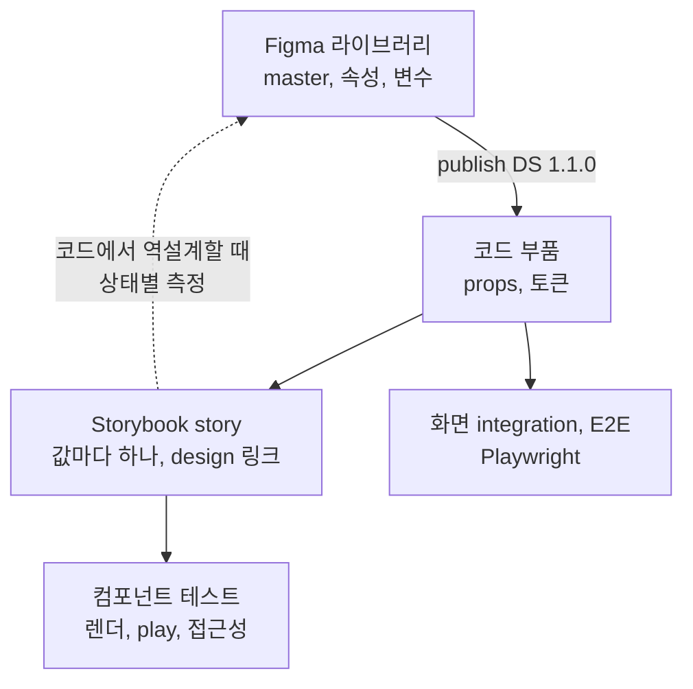

:::note[기록 시점]
2026-11-11. `sk-ax-gas-pp-storybook` 의 `.ignore/storybook-figma/`(README, CONVENTIONS v2.8, BRIEF, 도구 스크립트), Storybook 설정과 story 파일 54개, `test/` gallery, 이 저장소의 `figma`, `testing` skill, Figma 공식 `figma-generate-library` skill 을 읽고 정한 설계다.
Figma 파일 `SK-AX-GAS-PP-STORYBOOK`(`9tSd5yJsR0WIdPt4QPfzXp`)은 MCP 로 페이지 목록, `❖ button`, `❖ date-picker` 의 메타데이터와 스크린샷을 직접 확인했다.
Storybook, Vitest, Figma 사실은 같은 날 공식 문서에서 확인했다(Storybook 10.6.7, Vitest 5.1.0).
첫 판 뒤 사용자 의견으로 Figma skill 을 하나로 합쳤고, 컴포넌트 테스트 러너는 샘플 story 로 실측해 정했다.
:::

다음 프로젝트에서 GUI실과 Figma 에서 부품을 먼저 잡고, 코드와 Storybook 이 Figma 를 따라가고, story 가 곧 컴포넌트 테스트가 되게 하는 규칙을 skill 로 만든다.
재료는 샘플 저장소에서 연습한 Figma 규칙 v2.8 과 도구, Storybook story 다.

## 결정

| 결정 | 정한 것 | 이유 |
| --- | --- | --- |
| Figma skill | 하나. 지금 `figma` 앞에 라이브러리 구성 절을 더하고 제목을 Figma 컨벤션으로 | Figma URL 하나에 skill 하나가 걸린다. 둘이면 같은 URL 에 어느 skill 을 켤지 갈린다. 속성 축과 props 계약의 양쪽, MCP 읽기 규칙, 공식 skill 다루기를 한 라우터가 맡는다 |
| Storybook | 새 skill `storybook` | 대상이 story 파일과 `.storybook/` 설정이다. Figma 없이 story 만 고치는 일도 많다 |
| 컴포넌트 테스트 | `testing` 에 새 10절 `component`. 러너는 Storybook Vitest addon | 아래 판단 표. 상태와 단언이 story 한 곳에 있고, Storybook 이 권하는 길이다 |
| story 두 종류 | CSF story(`*.stories.tsx`, 부품 옆)는 ui, widget 카탈로그와 컴포넌트 테스트. gallery story(`test/**/*.story.tsx`)는 화면 구역 integration. 서로 가져오지 않는다 | 둘 다 샘플에 있고 소비자가 다르다. 같은 상태를 두 층에서 보지 않게 분담 규칙을 둔다 |
| 이름 하나 | ❖ 페이지 = 코드 폴더 = Storybook title. Figma 속성 값 = story export 이름. 예시 칸 이름 = 조합 story export 이름 | 링크 도구, 목차, 검사가 이름 대조로 돈다. 샘플의 `Empty`(story)와 `Placeholder`(Figma) 같은 어긋남을 없앤다 |
| 공식 Figma skill | 구성은 `figma-use`, `figma-generate-library`, 구현은 `figma-design-to-code` 를 먼저 읽는다. 부딪히면 이 skill 이 앞선다 | 지금 `figma` skill 이 `figma-design-to-code` 를 다루는 방식을 넓힌다 |
| Figma 도구 | 1단계는 규칙만 싣는다. 도구 묶음은 다음 프로젝트를 시작할 때 일반화한다 | 지금 도구는 이 파일의 노드 id(`sheet-state.json`)에 묶여 있다. 규칙이 검사 항목을 말하면 도구 없이도 확인할 수 있다 |

## 흐름

| 단계 | skill | 산출물 |
| --- | --- | --- |
| 부품을 그린다 | `figma` 1~7절 | ❖ 페이지, master, 변수, Changelog 줄 |
| 부품을 구현한다 | `figma` 8~12절, `react`, `css` | 부품 파일, 토큰 |
| story 를 쓴다 | `storybook` | `*.stories.tsx`, design 링크 |
| 상태를 검증한다 | `testing` 10절 | play 단언, 접근성 결과 |
| 화면에서 잇는다 | `testing` 1~9절 | integration, E2E |

## 이름 하나로 잇기

`date-picker` 로 따라가 본 대응. Figma 는 MCP 로 읽은 지금 파일이고, 지금 샘플 코드와 다른 칸은 괄호에 적었다.

| 자리 | Figma | 코드 | Storybook | 컴포넌트 테스트 |
| --- | --- | --- | --- | --- |
| 부품 | `❖ date-picker`, master `date-picker`(Size × Value × State 30) | `component/ui/date-picker/date-picker.tsx` | title `component/ui/date-picker` | 같은 story |
| 값 있음 | `Size=Medium, Value=Filled, State=Default` | `value="2026-05-30"` | `Filled` | 렌더, 접근성 |
| 값 없음 | `Value=Placeholder` | `value=""` | `Placeholder` (지금 `Empty`) | 렌더, 접근성 |
| 오류 | `State=Error` | `error` | `Error` (지금 `WithError`) | `aria-invalid` 단언 |
| 열린 달력 | `examples` 칸 `Open` | 달력 버튼 클릭 | `Open`, play 로 연다 | 달력이 열리고 30일이 선택됐는지 단언 |
| 범위 밖 날 | `examples` 칸 `OpenWithDateRange` | `minDate`, `maxDate` | `OpenWithDateRange` | 범위 밖 날이 비활성인지 단언 |
| Small, Large | `Size=Small`, `Size=Large` | 없음 | 없음 | 없음 |
| Hover, Focus, Disabled | 제안 variant, 설명 `코드에 없는 제안` | 없음 | 없음 | 없음 |
| 연결 | variant 노드 `393:1354` | | `parameters.design` | |

예시 칸 이름은 이미 story export 이름과 같다. 섹션 머리글(`_header`)은 `component/ui`, 부품 이름, 코드 경로, Storybook 경로와 story 수를 싣는다.

## 지금 상태

| 자리 | 있는 것 | 빈 곳 |
| --- | --- | --- |
| `figma` skill, 규칙 16 | MCP 읽기 순서, 의도, 값의 출처, 옮기기, 검증 | Figma 파일을 만들고 고치는 규칙. "Figma 는 참고, 스펙은 코드" 전제라 라이브러리 master 기준 구현이 없다 |
| `testing` 09절, 규칙 2 | Playwright gallery story 와 소비 spec | Storybook story, 컴포넌트 층 |
| 샘플 Figma 파일 | 페이지 54(구분선 4). button 은 Color × Variant × Size × State 135, `loading-button` 은 따로 | 규칙을 사람이 손으로 지킨다 |
| 샘플 Figma 규칙 v2.8 | 11절. 앞머리, 순서, 레이어, 이름, 속성, 값, 노트, 상태 표시, 추가 순서, 차트, 배포 | skill 형식(`appliesWhen`, 예제, 검사) |
| 샘플 도구 | `ds/figma-lib.js` 도우미, `ds/lint.js` 검사 25종, `ds/layout-all.js`, 링크 도구, 측정 스크립트 | 노드 id 를 품고 있어 다른 파일에 못 쓴다 |
| 샘플 Storybook | 10.6.5, `addon-designs`, story 파일 54(ui 42, widget 12), design 링크, 부모 문맥 CSS | 테스트 실행 없음. play 16개는 상태 재현만 하고 `expect` 는 0개. 접근성 검사 없음 |
| 샘플 ui, widget | 서버 데이터는 화면이 읽어 props 로 넘긴다. query 훅, fetch 호출 0 | |

::part[figma]

## 자리와 이름

| 항목 | 값 |
| --- | --- |
| 폴더 | `skill/figma` 그대로 |
| 라우터 | `convention-figma` 그대로. 프로젝트 `AGENTS.md` 는 고칠 것이 없다 |
| 제목 | Figma 구현 컨벤션 → Figma 컨벤션 |
| 사이트 | Tool 묶음 첫째 |
| companion | `react`, `css` conditional 그대로. `storybook` conditional 을 더한다. story 파일이나 design 링크를 바꿀 때 |
| 함께 읽는 공식 skill | 구성은 `figma-use`, `figma-generate-library`. 구현은 `figma-design-to-code` |

라우터는 작업 종류부터 가른다.

| 작업 | 신호 | 먼저 읽을 절 |
| --- | --- | --- |
| 라이브러리 구성 | Figma 에 쓴다. master, 속성, 변수, 노트, 릴리스를 만들거나 고친다. 코드 부품을 master 로 그린다 | 1~7절 |
| 구현 | Figma URL, 노드, 스크린샷을 읽고 코드를 바꾼다 | 8절 read |
| 둘 다 | master 를 고치고 코드도 맞춘다 | 1~7절 다음 8절 |

범위에 들지 않는 것은 화면 파일 구성이다. 샘플에 한 줄뿐이라 이번에 뺀다.

## 섹션과 규칙

열두 섹션, 규칙 46개. 1~7절이 새 라이브러리 구성 절이고 8~12절은 지금 규칙 16개의 번호만 옮긴 것이다. 출처는 샘플 CONVENTIONS 의 절 번호다.

| ID | 규칙 | 등급 | 요지 | 출처 |
| --- | --- | --- | --- | --- |
| F01-01 | file-keep-the-library-apart-from-screen-files | HIGH | 라이브러리 파일 하나. 화면 파일은 publish 된 라이브러리를 받아 쓴다. 변경이 화면과 코드에 가는 길은 publish 하나 | 11 |
| F01-02 | file-mark-each-page-kind-with-one-symbol | HIGH | ★ 표지, ¶ 안내, # 묶음 목차, ∷ 토큰, ❖ master, ✱ 문서용 부품. 이모지 없음. 묶음 사이 구분선 | 1 |
| F01-03 | file-name-component-pages-after-code-components | HIGH | ❖ 이름 = 코드 부품 폴더 이름(kebab-case) = Storybook title 끝. 표지 → 안내 → foundation → ui → widget → utility, 묶음 안 가나다 | 2 |
| F01-04 | file-merge-same-role-parts-into-one-master | HIGH | 같은 역할 코드 부품 둘은 master 하나. 코드가 바뀌어야 하면 노란 노트. master 없는 코드 부품은 목차의 `코드에만 있음` 카드 | 2, 8 |
| F02-01 | layer-use-sections-only-for-master-groups | HIGH | 섹션은 개발에 넘기는 master 묶음(Ready for dev 단위). 예시, 목차, 안내, 견본은 frame | 1, 3 |
| F02-02 | layer-put-masters-directly-under-the-section | HIGH | 감싸는 frame 없이 master → `_labels / <이름>` → `_note / dated` → `_header`. 머리글에 코드 경로와 Storybook 경로 | 3 |
| F02-03 | layer-prefix-doc-parts-and-private-masters | HIGH | `_` 는 문서용 부품과 레이어, `.` 는 다른 master 안에서만 쓰는 보조 master. 둘 다 publish 에서 숨는다 | 1 |
| F02-04 | layer-name-layers-by-role | HIGH | Title Case 역할 이름(`Label`, `Icon`, `Value`)은 코드 BEM 요소와 같다. 기본 이름 금지(`Vector` 만 예외). 가운뎃점 금지 | 4 |
| F02-05 | layer-lay-variants-out-as-a-labeled-matrix | MEDIUM | 행은 Size → State, 열은 나머지. 기본 variant 는 왼쪽 위. 이름표와 선은 `_Matrix` 인스턴스만. 왼쪽 끝 기준선 | 3 |
| F02-06 | layer-show-compositions-in-the-examples-frame | MEDIUM | story 중 조합만 `examples` frame 에. 칸 이름은 그 story export 이름. 섹션과 같은 x, 폭. variant 하나로 되는 story 는 예시 없음 | 3 |
| F02-07 | layer-grow-masters-downward-for-attached-text | MEDIUM | 오류, 도움말이 붙는 부품은 위 정렬과 내용 높이. 옆 글자는 입력칸 높이 안 가운데 | 3 |
| F03-01 | property-share-axis-names-values-and-order | CRITICAL | 종류(`Color`, `Variant`, `Type`) → `Size` → 내용 → `State`. 공통 값 Title Case. Size 는 작은 것부터, State 값 순서 고정 | 5 |
| F03-02 | property-choose-the-type-by-what-changes | HIGH | 글자 TEXT, 켜고 끄는 부분 BOOLEAN(`Suffix` + `Suffix text`), 아이콘 INSTANCE_SWAP, 다른 부품 자리 SLOT, 모양 축 VARIANT | 5 |
| F03-03 | property-draw-missing-states-as-marked-proposals | HIGH | 코드에 없는 hover, focus, disabled 도 그린다. 값은 코드의 비슷한 표현과 기존 토큰. variant 설명에 `코드에 없는 제안` | 5, 6 |
| F03-04 | property-split-states-that-break-the-grid | HIGH | 모양이 달라 오와 열이 안 맞는 상태는 따로 master(`loading-button`). 축이 독립이면 큰 set 도 한 set | 3 |
| F03-05 | property-keep-placeholder-copy-in-ui-masters | MEDIUM | ui master 글자는 더미(버튼, 옵션 1). 공통 동작 이름은 그대로. 업무 문구는 widget 과 예시에만 | 5 |
| F04-01 | variable-bind-visual-values-to-variables-and-styles | HIGH | 색, 간격, 모서리, 글자, 효과는 변수와 스타일. master 는 semantic 컬렉션만, primitive 는 숨기고 scope 없음 | 6 |
| F04-02 | variable-name-variables-after-code-tokens | HIGH | 역할 경로(`text/`, `border/`, `bg/` …), 값은 primitive 별칭, scope 지정, Web 코드 문법에 코드 토큰 `var(--app-…)` | 6 |
| F05-01 | note-write-only-what-the-canvas-cannot-show | MEDIUM | 기획 변경, 알릴 것, 고민만. 구조, 크기, 색, 코드 이야기, Dev Mode 주석은 쓰지 않는다 | 7 |
| F05-02 | note-sign-dated-notes-and-remove-them-when-settled | MEDIUM | 노란 노트는 작성자와 날짜(모르면 `unknown`). 반영되면 지우고 Changelog 한 줄 | 7 |
| F05-03 | note-describe-masters-with-purpose-and-code-path | MEDIUM | master 설명은 용도 한 줄과 코드 경로. 목차 카드 상태 말(`N variants`, `합침 → 부품`, `준비 중`) | 5, 8 |
| F06-01 | release-version-the-whole-library-with-one-number | HIGH | `DS 1.1.0` 하나. 지움과 이름 바꿈은 major, 추가는 minor, 모양만은 patch, 문서는 그대로 | 11 |
| F06-02 | release-log-changes-only-in-the-changelog-page | HIGH | `¶ Changelog` 의 `다음` 칸에 한 줄, 범위 글자에 섹션 링크. 부품 페이지에 이력을 두지 않는다 | 11 |
| F06-03 | release-edit-masters-in-place-to-keep-node-ids | CRITICAL | master 를 지우고 다시 만들지 않는다. 인스턴스와 Storybook 링크가 node id 를 가리킨다. 합치거나 지우면 major 와 링크 갱신 | 11 |
| F06-04 | release-publish-with-the-version-and-record-it-in-code | HIGH | publish 설명 첫 줄에 번호. Ready for dev 섹션은 Done with changes. 개발은 반영 버전을 Storybook 에, PR 제목에 번호와 부품 | 11 |
| F07-01 | script-read-the-official-skills-and-keep-these-names | HIGH | `use_figma` 전에 `figma-use`, `figma-generate-library` 를 읽는다. 아래 표의 항목은 이 skill 이 앞선다 | BRIEF |
| F07-02 | script-write-one-script-at-a-time-from-one-owner | HIGH | 분석은 병렬, Figma 쓰기는 한 담당이 차례로. 새 토큰은 `NEW color/<이름> = <값> [scopes] — 이유` 목록으로 모아 먼저 만든다 | README, BRIEF |
| F07-03 | script-check-plugin-api-pitfalls-before-writing | HIGH | variant 값 순서, clone 뒤 속성 연결, 인스턴스 안 숨긴 레이어와 slot, 같은 호출 안 크기 읽기, 변수 칠하기 투명도 등 함정 표 | README 주의 |
| F07-04 | script-derive-properties-from-code-and-measured-stories | HIGH | 코드에서 그릴 때 props, CSS, 사용처 → Storybook 상태별 계산 스타일 → 속성 설계 → 토큰 대응 → spec → 빌드 | 9, BRIEF |
| F08-01~05 | read-… 다섯 | 그대로 | 지금 F01. MCP 읽기 순서, 노드 고르기, `get_design_context` 범위, 문구, 숨긴 레이어 | |
| F09-01~04 | intent-… 넷 | 그대로 | 지금 F02. UX 메모와 GUI 충돌, 그려지지 않은 상태, 샘플 크기, 암시된 상호작용 | |
| F10-01~02 | source-… 둘 | 그대로 | 지금 F03. 토큰 대응, 고정 문구와 서버 데이터 | |
| F11-01~03 | transcription-… 셋 | 그대로 | 지금 F04. 기존 부품 재사용, 레이어 구조 복사 금지, 아이콘과 에셋 | |
| F11-04 | transcription-carry-library-properties-into-props-and-stories | HIGH | master 로 부품을 구현하면 속성 축은 props, 값은 story, variant 노드는 design 링크. 제안 상태를 구현할지는 정해서 기록 | 새 규칙 |
| F12-01 | verify-measure-rendered-values-before-claiming-parity | HIGH | 지금 F05-01. 라이브러리 작업 줄을 더한다. 검사 위반 0(페이지 이름, master 깊이, 묶이지 않은 색, 속성 순서, 노트 날짜), 바뀐 섹션 스크린샷을 Storybook 과 대조 | 지금 규칙, README |
| F12-02 | verify-report-reads-decisions-and-gaps | HIGH | 지금 F05-02. 라이브러리 작업 줄을 더한다. 바뀐 master 와 variant 수, 제안 상태, 새 토큰, 갱신한 링크, Changelog 줄, 남은 노트 | 지금 규칙 |

두 verify 규칙은 지금처럼 `requiredOnCompletion` 이다. 표의 작업 종류 줄이 구현과 구성을 가르므로 구성만 한 작업에 렌더 실측을 묻지 않는다.
개요 문장도 바꾼다. "Figma 는 참고 자료이고 스펙은 코드" 는 화면 파일 이야기로 좁히고, 라이브러리 master 는 모양과 속성 축의 기준이라고 적는다. 동작과 데이터의 스펙은 여전히 코드다.
구현하며 합칠 후보는 F02-07 → F02-02, F03-05 → F05-03 이다. 차트 부품 규칙(CONVENTIONS 10절)은 프로젝트 예시로 남긴다.

## 공식 skill 과 부딪히는 곳

`figma-generate-library` 는 "파일의 기존 규칙을 따르라"고 한다. 아래 기본값은 이 skill 이 앞선다.

| 항목 | `figma-generate-library` 기본 | 이 skill |
| --- | --- | --- |
| 부품 이름 | PascalCase `Button` | 코드 이름 kebab-case `button` |
| 내부 부품 | `_Parent/Sub` | `.select/option`. `_` 는 문서용 부품 |
| 페이지 이름 | 맨 이름이나 이모지 | 채도 없는 기호 하나 |
| variant 상한 | 30 을 넘으면 나눈다 | 축이 독립이면 한 set(button 135). 모양이 격자를 깨면 나눈다 |
| Code Connect | 전체 라이브러리 범위에 든다 | 범위 밖. Storybook design 링크가 코드와 잇는다 |

같은 것. 변수 scope 지정(ALL_SCOPES 금지), Web 코드 문법, semantic 의 primitive 별칭, 아이콘은 INSTANCE_SWAP, `use_figma` 차례 실행.

::part[storybook]

## 자리와 이름

| 항목 | 값 |
| --- | --- |
| 폴더 | `skill/storybook` |
| 라우터 | `convention-storybook` |
| 제목 | Storybook 컨벤션 |
| 사이트 | Tool 묶음, Figma 뒤 |
| 인덱스 글자 | S |
| companion | `typescript` required. `react`, `css`, `testing` conditional |

범위에 드는 것.

- `.storybook/` 설정, `*.stories.tsx`, story 문맥 CSS, design 링크
- Storybook 빌드와 배포

범위에 들지 않는 것.

- gallery story(`test/**/*.story.tsx`). `testing` 09절이다
- 화면 전체 story. 화면은 integration 과 앱 mock 모드가 맡는다

## 섹션과 규칙

여섯 섹션, 규칙 17개.

| ID | 규칙 | 등급 | 요지 |
| --- | --- | --- | --- |
| S01-01 | setup-collect-only-component-stories | HIGH | `stories` 는 `src/component/**/*.stories.tsx`. addon 은 쓰는 것만(`addon-designs`, `addon-vitest`, `addon-a11y`). telemetry 끔. 패키지 버전 하나 |
| S01-02 | setup-wrap-every-story-in-the-app-providers | HIGH | preview 데코레이터 하나에 앱과 같은 provider, 전역 CSS, 글꼴. layout 기본 `centered`, 폭을 채우는 부품만 meta 에서 `padded` |
| S01-03 | setup-keep-env-and-api-addresses-out-of-the-build | HIGH | Storybook 전용 vite 설정에 렌더에 필요한 별칭과 플러그인만. `env/` 와 API 주소를 싣지 않는다. 모듈 대체는 preview 의 `sb.mock` 에서만 |
| S01-04 | setup-sort-the-sidebar-like-the-figma-file | MEDIUM | `storySort` 는 `['component', ['ui', 'widget']]`, 가나다. story 는 파일에 쓴 순서 = Figma 행렬 순서 |
| S02-01 | file-keep-one-story-file-next-to-each-component | HIGH | `<부품>.stories.tsx` 를 부품 폴더에. 부품 하나에 파일 하나. story 만 쓰는 도우미는 그 파일 안 |
| S02-02 | file-title-stories-with-the-figma-page-name | HIGH | `title: 'component/ui/date-picker'`. 이름이 바뀌면 story id 가 바뀌므로 링크를 다시 만든다 |
| S02-03 | file-name-stories-after-figma-property-values | HIGH | export 이름 = Figma 값 PascalCase(`Placeholder`, `Error`), 조합은 이어 붙임. 첫 story 는 Figma 기본 variant. export 이름이 테스트 이름이 된다 |
| S03-01 | story-type-meta-with-satisfies-and-put-defaults-in-args | HIGH | `satisfies Meta<typeof X>`, `StoryObj<typeof meta>`. meta `args` 에 기본 variant 값, 필수 props, 콜백 `fn()`. story 는 차이만 |
| S03-02 | story-reach-states-through-args-then-before-each-then-play | HIGH | args → 외부 store 와 시간은 `beforeEach` → 조작이 있어야 생기는 상태만 `play`. 서버 데이터는 props 로 받고 네트워크 mock 을 두지 않는다. 포털 내용은 `screen` |
| S03-03 | story-cover-every-figma-value-once | HIGH | Figma 속성 값마다 story 하나 이상. 조합은 화면이 쓰거나 배치가 달라질 때만. `examples` 칸은 조합 story. 제안 상태는 구현될 때 |
| S03-04 | story-reproduce-parent-context-with-copied-values | MEDIUM | 부모 폭과 문맥은 데코레이터와 story 문맥 CSS. 값은 실제 부모 CSS 그대로, 상자에 출처. 지어낸 폭 금지 |
| S04-01 | design-link-each-story-to-its-figma-node | HIGH | `parameters.design` 에 variant 노드나 예시 칸 노드. 페이지, 섹션 링크 금지. master 없는 부품은 링크 없이 meta 상자에 이유 |
| S04-02 | design-regenerate-links-from-the-library-build | HIGH | story id → node id 표에서 도구로 일괄. 손으로 고치지 않는다. export 나 title 을 바꾸면 다시 돌린다 |
| S04-03 | design-map-figma-properties-to-props-in-the-meta-box | MEDIUM | Figma 속성과 props 의 이름이나 값이 다르면 meta 위 상자 목록에 대응(`Variant Fill: variant="contained"`). 같으면 없음 |
| S05-01 | docs-leave-usage-guidance-to-the-figma-library | MEDIUM | Storybook 은 코드의 지금 모습. 사용 지침과 의도는 Figma `¶ Read me` 와 master 설명. MDX, autodocs 없음 |
| S05-02 | docs-show-the-applied-library-version | MEDIUM | 반영한 `DS 1.1.0` 을 `manager.ts` 의 `brandTitle` 에. `storybook build` 결과를 공유 |
| S06-01 | verify-build-storybook-and-run-story-tests | HIGH | `storybook build` 성공, `vitest --project=storybook` 의 실행 수와 실패, design 링크 누락 0 을 보고. `requiredOnCompletion` |

S05-01 은 Storybook 문서와 갈린다. Storybook 은 story 설명을 JSDoc 으로 쓰라고 권하지만, 이 저장소는 `//` 상자만 쓰고 문서 페이지를 만들지 않는다.
설명 페이지가 필요해지면 `parameters.docs.description` 문자열로 단다.

::part[testing]

## 컴포넌트 테스트 판단

| 기준 | Storybook Vitest addon | Playwright gallery 에서 story mount |
| --- | --- | --- |
| 공식 지원 | Storybook 이 권한다. 모든 story 가 렌더 테스트, play 가 있으면 함께 실행 | Playwright 의 gallery 와 `mount` 는 공식이다. 하지만 CSF story 를 읽는 연동은 Storybook 이 지웠다. `composeStories` 연결을 우리가 만들고 지켜야 한다 |
| 지역성 | 상태(args, play)와 단언이 story 한 곳 | story 와 spec 두 파일을 story id 로 잇는다 |
| Figma → story → 테스트 | Storybook 화면에서 design 탭 옆에 테스트와 접근성 결과 | 결과는 Playwright 보고서에만 |
| 러너 | Vitest browser project 하나를 더한다(Chromium 은 같음) | Playwright 하나로 integration, E2E 와 같다 |
| 단언 문법 | Testing Library 질의(`canvas.getByRole`)와 `expect` | Playwright locator 와 `expect`. testing 5절 그대로 |
| 네트워크 | 필요 없다. ui, widget 은 서버 데이터를 읽지 않는다 | 같음 |
| 접근성 | `addon-a11y` 의 `test: 'error'` 설정 하나 | `@axe-core/playwright` 를 따로 붙인다 |
| 디버깅 | Interactions 패널에서 play 단계 되감기 | trace viewer, UI 모드 |

Vitest addon 도 브라우저는 Playwright 가 띄운다(Vitest 브라우저 모드, Chromium). 갈리는 것은 러너와 단언 자리다.
Storybook 의 Playwright 기반 test-runner(Jest + Playwright)는 Vitest addon 으로 대체됐고, Vite 프로젝트에는 Vitest addon 을 권한다.

정한 것은 Vitest addon 이다. 갈림길은 러너 수와 단언 문법인데, 둘 다 학습 비용이지 결과 품질의 차이가 아니다.
반대로 Playwright 쪽은 Storybook 이 지운 연동을 우리가 떠안고, story 와 단언이 두 파일로 갈라진다.
화면 구역 integration 과 E2E 는 지금처럼 Playwright gallery 와 앱이 맡는다.

### 실측

샘플 사본에 Vitest addon 을 붙여 돌렸다. story 와 `AppProviders`, MUI, emotion, NiceModal, 글꼴, CSS 는 고치지 않았다.

| 실행 | 테스트 | 통과 | 실패 | 시간 |
| --- | --- | --- | --- | --- |
| addon-vitest 만 | 197(story 파일 54) | 197 | 0 | 6~8초 |
| `a11y.test: 'error'` 추가 | 197 | 147 | 50 | 12초 |

- 실패 50 은 모두 axe 위반이다. `color-contrast` 26, `aria-progressbar-name` 7, `label` 5, `aria-dialog-name` 5, `aria-prohibited-attr` 4, `aria-conditional-attr` 2, `scrollable-region-focusable` 2. 이름 없는 MUI 달력 팝업(`role=dialog`), 이름표 없는 체크박스, 4.5:1 에 못 미치는 `#868e96` 글자 같은 실제 결함이다.
- date-picker `Open` 의 play 에 `screen.findByRole('grid')` 단언을 넣자 통과했고, 일부러 틀린 기대값은 읽을 수 있는 메시지로 실패했다.
- MUI 전환 효과가 있는 부품은 `findBy` 가 풀린 순간 opacity 0 이다. 보이는지는 `waitFor` 안에서 단언한다.
- CLI 는 `storybook` project 를 `.storybook/vite.config.ts` 에 넣는데 Vitest 는 그 파일을 읽지 않는다. 루트 `vite.config.ts` 의 `test.projects` 에 둔다.
- CLI 가 `playwright: "latest"` 를 적는다. 다른 의존성처럼 버전을 고정한다.
- `--project` 없는 `vitest run` 은 브라우저 project 까지 돈다. unit 스크립트는 `--project unit` 을 붙인다.

결정에 더하는 것. 새 프로젝트는 첫날부터 `a11y.test: 'error'` 로 시작한다. 기존 프로젝트에 붙일 때는 `'todo'` 로 켜고 위반을 고친 뒤 `'error'` 로 올린다.

## testing 바꿈

| 자리 | 바꿈 |
| --- | --- |
| 01-01 경계 표 | component 층을 더한다. 부품 하나를 story 로 렌더해 상호작용과 접근성을 본다. Storybook Vitest addon |
| 01-02 층 분담 | 부품 하나의 props, 입력, 상호작용은 component. 화면 구역의 응답, URL, 이동은 integration. 같은 상태를 두 층에서 보지 않는다 |
| 01-03 러너 수집 | Vitest `storybook` project 를 루트 설정의 `test.projects` 에 unit, golden 과 나란히 둔다. 스크립트는 `--project` 로 고른다 |
| 03-02 시간 통제 | story 의 시간은 오늘을 돌려주는 모듈을 `sb.mock` 으로 바꾸고 `beforeEach` 에서 값을 정한다 |
| 09절 | 제목을 Gallery story 로. Playwright 문서는 gallery 방식을 component testing 이라 부르지만 여기서는 화면 구역 integration 층이라는 문장을 둔다 |

새 10절 `component`. 규칙 셋.

| ID | 규칙 | 등급 | 요지 |
| --- | --- | --- | --- |
| T10-01 | component-run-every-story-as-a-test | HIGH | 모든 story 가 렌더 테스트다(`test` 태그 기본). 테스트 환경에서 못 도는 story 만 `tags: ['!test']` 와 이유. 수집 수와 실행 수를 맞춘다 |
| T10-02 | component-assert-the-state-each-play-reaches | HIGH | play 가 만든 상태는 같은 play 에서 단언한다. `canvas`, `screen`, role 과 label, `fn()` 호출. 전환 효과는 `waitFor` 안에서. 기대값은 Figma 와 spec 계약. GWT 주석은 없다 |
| T10-03 | component-fail-stories-on-accessibility-violations | HIGH | preview 에 `a11y.test: 'error'`. 예외는 story 의 `'todo'` 와 이유. 기존 프로젝트는 `'todo'` 로 켜고 고친 뒤 올린다 |

## 계층

| skill | 켜는 skill | 자리 |
| --- | --- | --- |
| `blueprint` | `figma`, `testing` | 맨 위 |
| `figma` | `react`, `css`, `storybook` | 위 |
| `storybook` | `typescript`, `react`, `css`, `testing` | 가운데 |
| `testing` | `typescript`, `react`, `css` | 아래 |
| `react` | `typescript` | 아래 |
| `typescript` | 없음 | 맨 아래 |

`testing` 은 `storybook` 을 켜지 않는다. play 를 고치는 일은 story 파일을 고치는 일이라 `storybook` 이 먼저 켜지고 `testing` 을 부른다.

::part[구현]

## 예제

| skill | 꼴 | 세계관 |
| --- | --- | --- |
| `figma` 1~7절 | 페이지 목록, 레이어 나무, 속성 표, 노트, Changelog 줄은 `.markdown`. Plugin API 쓰기는 `.js` | ui 는 범용 부품(button, text-field, date-picker, select), widget 은 관리자 콘솔 |
| `storybook` | `*.stories.tsx`(Correct 는 typecheck), `.storybook/main.ts`, `preview.tsx`, `manager.ts`, 문맥 `.css` | 관리자 콘솔 |
| `testing` 10절 | play 단언이 든 `*.stories.tsx` | 관리자 콘솔 |

devDependencies 에 `storybook`, `@storybook/react-vite` 를 더한다. 예제 typecheck 가 `storybook/test` 와 `Meta`, `StoryObj` 를 읽어야 한다.

## routing-evals

| skill | 시나리오 | 기대 |
| --- | --- | --- |
| `figma` | 코드의 select 를 Figma master 로 그린다 | F01-03, F02 전부, F03 전부, F04 전부, F07 전부, F12 전부, companion storybook |
| `figma` | DS 1.1.0 릴리스를 정리한다 | F06 전부, F12 전부 |
| `figma` | 반영된 노란 노트를 정리한다 | F05-01, F05-02, F06-02, F12 전부 |
| `figma` | button 에 Loading 상태를 더한다 | F02-05, F03-01, F03-04, F06-01, F06-03, F12 전부 |
| `figma` | master 기준으로 date-picker 를 구현한다 | F08 전부, F10-01, F11 전부, F12 전부, companion react, css, storybook |
| `storybook` | 새 부품의 story 를 쓴다 | S02 전부, S03-01~04, S04-01, S06-01 |
| `storybook` | Figma 가 바뀌어 링크를 갱신한다 | S04-02, S06-01 |
| `storybook` | 모달 widget 의 열린 상태 story | S03-02, S03-03, S06-01, companion testing |
| `storybook` | `.storybook` 에 addon 을 더한다 | S01-01, S01-03, S06-01 |

지금 `figma` evals 의 구현 시나리오는 번호만 바꿔 그대로 둔다. `testing` 10절은 기존 evals 에 시나리오 하나를 더한다.

## 단계

| 단계 | 내용 | 확인 |
| --- | --- | --- |
| 1 | 이 설계 문서 | |
| 2 | `testing` 손질과 10절. 예제, evals, `test/testing.test.ts` 의 09절 이름 | `npm run check` |
| 3 | `storybook` skill. `brandTitle` 이 10.6 에서 그대로인지 먼저 확인 | `npm run check` |
| 4 | `figma` 합치기. 지금 1~5절을 8~12절로 옮기고 1~7절을 더한다. 개요, 라우터, companion, F11-04, F12 두 규칙의 라이브러리 줄 | `npm run check` |
| 5 | 등록. `src/site.ts` Tool 순서(Figma, Storybook, Blueprint), README, AGENTS, CONTRIBUTING, tooling, usage, 테스트 | `npm run check`, `npm run content:build` |
| 6 | Figma 도구 묶음 일반화. 다음 프로젝트를 시작할 때 | |

단계마다 커밋하고 main 에 합친다.

## 나중

| 항목 | 미루는 이유 |
| --- | --- |
| 화면 파일 규칙 | 샘플에 한 줄뿐이다. GUI실과 첫 화면 파일을 만들 때 정한다 |
| 시각 비교 | Storybook 공식은 Chromatic 뿐이다. Vitest `toMatchScreenshot` 은 Storybook 과 잇는 문서가 없다 |
| Code Connect | Professional 은 라이브러리 하나, 프레임워크 하나로 묶이고 Dev 나 Full seat 가 필요하다. 지금은 design 링크로 충분하다 |
| props 값을 Figma 값에 맞추기 | `react` 규칙감이다. 지금은 S04-03 의 대응 목록으로 둔다 |
| 토큰 이름 대응 | Figma `bg/surface` 와 코드 `--app-color-surface` 의 변환 규칙. `css` C05-05 와 함께 정한다 |
| 변수 이름 줄임말 | Figma 문서는 줄임말 대신 온전한 낱말을 권한다. `bg/` 는 코드 토큰과 맞추려는 선택이라 유지한다 |

## 참고

확인한 문서만 적었다.

- Storybook: [Vitest addon](https://storybook.js.org/docs/writing-tests/integrations/vitest-addon), [Test runner](https://storybook.js.org/docs/writing-tests/integrations/test-runner), [Interaction tests](https://storybook.js.org/docs/writing-tests/interaction-testing), [Play function](https://storybook.js.org/docs/writing-stories/play-function), [Accessibility tests](https://storybook.js.org/docs/writing-tests/accessibility-testing), [Mocking modules](https://storybook.js.org/docs/writing-stories/mocking-data-and-modules/mocking-modules), [Naming components and hierarchy](https://storybook.js.org/docs/writing-stories/naming-components-and-hierarchy), [Portable stories in Vitest](https://storybook.js.org/docs/api/portable-stories/portable-stories-vitest), [Visual tests](https://storybook.js.org/docs/writing-tests/visual-testing), [Autodocs](https://storybook.js.org/docs/writing-docs/autodocs), [Description block](https://storybook.js.org/docs/api/doc-blocks/doc-block-description), [addon-designs](https://github.com/storybookjs/addon-designs), [Playwright CT 연동 삭제](https://github.com/storybookjs/storybook/blob/main/MIGRATION.md#experimental-playwright-ct-integration-removed)
- Playwright: [Components](https://playwright.dev/docs/test-components)
- Vitest: [Visual regression testing](https://vitest.dev/guide/browser/visual-regression-testing)
- Figma: [Component properties](https://help.figma.com/hc/en-us/articles/5579474826519-Explore-component-properties), [Slots](https://help.figma.com/hc/en-us/articles/38231200344599-Use-slots-to-build-flexible-components-in-Figma), [Variables, collections, modes](https://help.figma.com/hc/en-us/articles/14506821864087-Overview-of-variables-collections-and-modes), [Tokens, variables, styles](https://help.figma.com/hc/en-us/articles/18490793776023-Update-1-Tokens-variables-and-styles), [Sections](https://help.figma.com/hc/en-us/articles/9771500257687-Organize-your-canvas-with-sections), [Dev Mode statuses](https://help.figma.com/hc/en-us/articles/26781702258583-Dev-Mode-statuses-and-notifications), [Publish a library](https://help.figma.com/hc/en-us/articles/360025508373-Publish-a-library), [Review library updates](https://help.figma.com/hc/en-us/articles/360039234193-Review-and-accept-library-updates), [Code Connect](https://help.figma.com/hc/en-us/articles/23920389749655-Code-Connect), [Pages and dividers](https://help.figma.com/hc/en-us/articles/360038511293-Create-and-manage-pages), [PageNode](https://developers.figma.com/docs/plugins/api/PageNode/)
