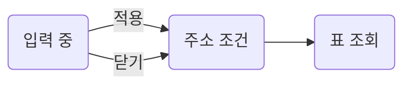

Design. Figma 10-02, spec 10-01, 데모 3.
조건으로 거른 주문을 보는 표. 행을 누르면 주문 상세.

## Overview

구역 2개, 화면 위에서 아래 순서.

| # | Region | Content |
| --- | --- | --- |
| 1 | [Condition popover](#condition-popover) | 상태, 기간, 고객명. 적용 때만 목록 갱신 |
| 2 | [Orders table](#orders-table) | 11열, 정렬, 페이지, 행 누름 |

- 대기, 빈 값, 실패 = [Loading, empty and errors](#loading-empty-and-errors). 완료 기준 = [Scenarios](#scenarios)
- 링크 걸린 글, 규칙, 부품은 여러 화면이 같이 씀. 정의는 [Shared](../shared.md)

## Plan

구현 순서와 단계마다 확인 방법. Depends on = 그 단계가 기다리는 열린 질문.

| Stage | Work | Depends on | Check | Status |
| --- | --- | --- | --- | --- |
| 0 | 준비. `ui/popover` 승격 | — | `npx tsc -b` | Done 2026-10-03 |
| 1 | 조건 팝오버 | — | `npm run test:integration -- orders` | Ready |
| 2 | 주문 표 | [Q1](#q1) | `npm run test:integration -- orders` | Blocked |

열린 질문 1. 막는 것 = 2단계 → [Questions](#questions)

## Questions

열린 것 1개, 풀린 것 1개. 줄을 누르면 카드가 열림.

:::details[Q1 환불 주문을 목록에 포함하나요? Needs answer]
<a id="q1"></a>

| To | Blocks | Where |
| --- | --- | --- |
| 기획 | Plan 2단계 | [Orders table](#orders-table) › 환불 행 |

| Option | Answer | FE change |
| --- | --- | --- |
| A  | 포함. 상태 칩 `환불`로 구분 | 칩 하나 |
| B | 제외. 환불 탭을 따로 둠 | 탭과 조회 하나 |

- Why = 데모 3이 포함
:::

:::details[D2 조건 설정 = 모달 아닌 팝오버 Dev decision 2026-10-02]
<a id="d2"></a>

| Asked | Answer |
| --- | --- |
| 조건 설정을 띄우는 꼴 | 버튼에 붙는 팝오버. 표를 가리지 않음 |
:::

::part[Screen]

## Condition popover

조건은 적용 버튼에서만 목록에 반영.

<figure class="fx-shot" data-shot="figma-condition">
<div class="fx-shot__frame"><div class="fx-shot__marks" aria-hidden="true"><i style="left:6%;top:12%;width:88%;height:52%"><b>1</b></i><i style="left:52%;top:78%;width:42%;height:14%"><b>2</b></i></div></div>
<label class="fx-shot__toggle" title="구역 표시"><input type="checkbox" checked aria-label="구역 표시"></label>
</figure>

| # | Part | Rule | Figma |
| --- | --- | --- | --- |
| 1 | 조건 칸 3개 | 상태 select, 기간, 고객명. 빈 칸 = 조건 없음 | [ 12:350](https://www.figma.com/design/Ab12Cd34Ef56Gh78Ij90Kl/admin?node-id=12-350) |
| 2 | 적용, 초기화 | 적용 = 주소에 반영 → 목록 조회. 초기화 = 빈 칸으로 | [ 12:356](https://www.figma.com/design/Ab12Cd34Ef56Gh78Ij90Kl/admin?node-id=12-356) |

```text [src/page/orders/]
└── _pg-condition-popover.tsx   // 조건 칸, 적용, 초기화. 입력 중 값은 폼
```



## Orders table

서버 정렬과 페이지. 행 어디를 눌러도 주문 상세.

| # | Part | Rule | Figma |
| --- | --- | --- | --- |
| 1 | 열 머리 | 11열. 머리 누름 = [서버 정렬, 오름 → 내림 → 없음](../shared.md#toNextSortParams) | [ 12:344](https://www.figma.com/design/Ab12Cd34Ef56Gh78Ij90Kl/admin?node-id=12-344) |
| 2 | 행 | 누름 = 주문 상세 `orders/:orderId` | [ 12:345](https://www.figma.com/design/Ab12Cd34Ef56Gh78Ij90Kl/admin?node-id=12-345) |

| API | Hook | For |
| --- | --- | --- |
| `GET /api/orders` | `useGetOrders` | 행, 총 건수. 실패는 표 경계로 |

## Loading, empty and errors

표만 오류 경계. 조건 팝오버는 표가 실패해도 남음.

| Region | 대기 | 빈 값 | 실패 | Check |
| --- | --- | --- | --- | --- |
| [Orders table](#orders-table) | 대기 행 8줄 | 안내와 초기화 버튼 | 표 자리만 다시 시도 | [ORD-011](#test-ord-011)<br>[ORD-012](#test-ord-012) |

## Copy

| Region | Where | Text |
| --- | --- | --- |
| [Orders table](#orders-table) | 빈 목록 | 조건에 맞는 주문이 없습니다. |

::part[Structure]

## Reuse

이미 있는 부품을 쓰는 자리.

| Need | Use | Where |
| --- | --- | --- |
| 표, 페이지 | `ui/table`, `ui/pagination` | [Orders table](#orders-table) |
| 조건 팝오버 | `ui/popover` | [Condition popover](#condition-popover) |

## Data and API

| Endpoint | Caller | Query ← 출처 |
| --- | --- | --- |
| `GET /api/orders` | 표 | `status` ← 주소. `page`* ← 주소 |

- `*` = spec 필수

### Mock

| API | 정상 응답 | File |
| --- | --- | --- |
| `/api/orders` | BE 전 = Kubb 생성기 위 상태 섞인 20건 | `mock-orders.ts` |

| Case | API | 덮는 값 | Check |
| --- | --- | --- | --- |
| 주문 없음 | `/api/orders` | `items` = `[]` | [ORD-012](#test-ord-012) |

## State

| Key | Default | Changed by |
| --- | --- | --- |
| `status`, `from`, `to` | 없음 = 전체 | 적용, 초기화 |

## Rules

| Rule | Detail | Code |
| --- | --- | --- |
| 정렬 | 11열 중 9열. [서버 정렬, 오름 → 내림 → 없음](../shared.md#toNextSortParams) | `toNextSortParams` |

## Tree

```text [src/page/orders/]
├── pg-orders.tsx                 // 진입. 표 경계
├── _pg-condition-popover.tsx     // 조건
└── _pg-orders-table.tsx          // 표, 페이지
```

::part[Check]

## Scenarios

구현 전에 적는 완료 기준. 테스트 제목 = `[ID] 문장` 그대로.

| ID | Region | Scenario | Tag | Layer |
| --- | --- | --- | --- | --- |
| <a id="test-ord-011"></a>ORD-011 | [Loading, empty and errors](#loading-empty-and-errors) | 첫 조회 중에는 대기 행 8줄이 표시된다 | mid | integration |
| <a id="test-ord-012"></a>ORD-012 | [Orders table](#orders-table) | 주문이 없으면 안내와 초기화 버튼이 표시된다 | mid<br>negative | integration |

::part[Reference]

## Sources

:::details[Read sources]{open}
- Figma 10-02 [주문 목록 섹션](https://www.figma.com/design/Ab12Cd34Ef56Gh78Ij90Kl/admin?node-id=12-340)
- 데모 `orders-demo (3).html` 09-30
- spec `openapi.json` 10-01, 커밋 `e2a8cf31`
:::
