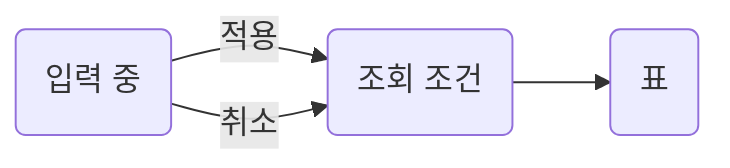

Design. Figma 10-02, spec 10-01.

## Capture

1. 조건 패널. 상태, 기간, 고객명
2. 주문 표. 11열, 페이지 없음
3. 행 누름 → 주문 상세

## Decisions

| # | Decision | Ref |
| --- | --- | --- |
| 1 | 조건 패널은 팝오버. 모달 아님 | D2 |
| 2 | 조건은 적용 버튼에서만 목록에 반영 | — |
| 3 | 정렬은 서버. FE 코드 0줄 | Follow-up |

## Remaining

| Stage | Work | Blocker | Check | Status |
| --- | --- | --- | --- | --- |
| 0 | 준비. 부품 승격 | — | `npx tsc -b` | Done 2026-10-03 |
| 1 | 조건 패널 | — | `npm run test:integration -- orders` | Ready |
| 2 | 주문 표 | [Q1](../questions.md#q1) | `npm run test:integration -- orders` | Blocked |
| 3 | 연동. 환불 금액 | — | `npm run kubb:generate && npx tsc -b` | Waiting on BE |

열린 카드 2. [Orders list](../questions.md#orders-list)

### Follow-up

- 서버 기본 정렬. FE 코드 0줄. 구현 뒤 캡처로 대조

### Expected from BE

| Field | Use | Fallback |
| --- | --- | --- |
| `refundAmount` | 환불 열 | 열 숨김 |

::part[Screen]

## Condition panel

조건은 적용 버튼에서만 목록에 반영.

| State | Shows |
| --- | --- |
| 대기 | 패널 자리의 스켈레톤 |
| 빈 결과 | 표 자리의 안내와 초기화 버튼 |
| 오류 | 패널 경계의 다시 시도 |

:::details[구현 상세]
- 폭 300 급, 오른쪽 정렬
- 입력 값은 `react-hook-form` draft, 적용 값은 URL
:::

## Orders table

::part[Structure]

## Reuse

| Path | What | Used in |
| --- | --- | --- |
| `component/ui/table` | 표, 정렬 머리 | 주문 표 |

## Data and API

| Endpoint | Hook | Used in |
| --- | --- | --- |
| `GET /api/orders` | `useGetOrders` | 표 |

## State

| Key | Where | Changed by |
| --- | --- | --- |
| `status`, `from`, `to` | URL | 적용, 초기화 |

## Tree

## Sources

:::details[읽은 재료]
- Figma 10-02 [목록 프레임](https://www.figma.com/design/Ab12Cd34Ef56Gh78Ij90Kl/admin?node-id=12-340)
- 데모 `orders-demo (3).html` 09-30
- spec `openapi.json` 10-01, 커밋 `e2a8cf31`
:::
