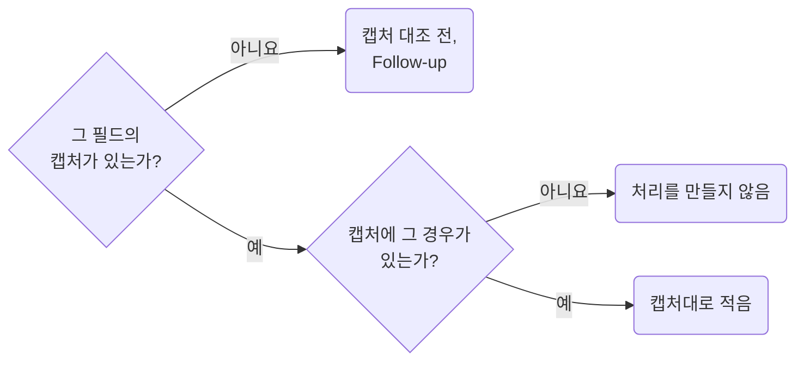

## Confirm Response Shapes with Captures

**Impact: CRITICAL (spec과 mock만 보고 적은 응답 모양이 실제 응답과 달라 화면이 틀리는 일을 막습니다)**

응답 필드의 뜻, 형식, 기준은 실제 응답 캡처로 확인하고 적습니다. mock은 spec 위에 만든 값이라 둘 다 같은 것을 모릅니다.

| 재료 | 알 수 있는 것 | 알 수 없는 것 |
| --- | --- | --- |
| spec | 필드 이름, 타입, 필수 여부 | 날짜 형식의 실제 모양, 코드 값의 실제 집합, 통계의 기준 |
| mock | 화면이 그려지는지 | 실제 값의 분포, 서버가 거르는 규칙 |
| 캡처 | 위 전부 | 아직 없는 endpoint |

spec에 `minItems`가 없다는 것은 빈 배열이 온다는 근거가 아닙니다. 캡처에 없는 경우는 처리를 만들지 않습니다.
캡처가 없으면 그 줄에 "캡처 대조 전"을 적고 Follow-up으로 둡니다. 추측한 형식을 확정처럼 쓰지 않습니다.
서버 문자열과 수치의 뜻을 물을지는 `question-filter-what-needs-another-person`이 정합니다.

**Incorrect 1 (mock 값과 spec만으로 형식과 빈 배열 처리를 확정합니다):**

<<< ../examples/material-confirm-response-shapes-with-captures/01-incorrect.markdown

**Correct 1 (캡처로 확인한 줄과 대조 전인 줄을 가르고 빈 배열 처리를 만들지 않습니다):**

<<< ../examples/material-confirm-response-shapes-with-captures/02-correct.markdown
