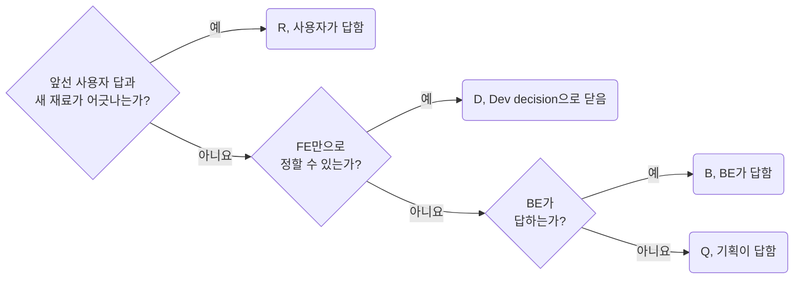

## Keep Cards in the Screen Doc

**Impact: CRITICAL (질문 칩을 누를 때마다 다른 문서로 튀지 않고 그 화면을 읽던 자리에서 질문과 답을 보게 합니다)**

질문 카드는 그 화면 문서의 `## Questions` 절에 둡니다. 번호는 프로젝트 안에서 하나이고 답하는 사람으로 가릅니다.

| 번호 | 뜻 | 답하는 사람 |
| --- | --- | --- |
| D | 개발 결정. 재료가 정하지 않았고 다른 선택지가 실제로 있던 갈림길은 질문 없이 정해도 D | 개발자. Dev decision으로 닫습니다 |
| Q | 기획과 디자인 질문 | 기획 |
| B | BE 질문 | BE |
| R | 다시 정할 것. 앞선 답과 새 재료가 어긋난 것 | 사용자 |

| 자리 | 쓰는 법 |
| --- | --- |
| 카드 | `:::details[Q3 질문 한 줄 Status]` 아코디언. 본문 첫 줄 `` |
| 같은 문서의 링크 | 번호 글자에 `#q3` 주소. 칩을 누르면 카드가 펼쳐짐 |
| 다른 문서의 링크 | 번호 글자에 `screen/orders.md#q3` 주소. 카드가 사는 화면 문서를 가리킴 |
| 두 화면에 걸친 질문 | 카드는 한 화면에만. 다른 화면의 `Questions` 절은 번호, 상태, 자리 표로 가리킴 |
| 화면에 묶이지 않는 질문 | `questions.md`의 `Project` 절에 카드 |
| `questions.md` 머리 | 화면별 목록 표. `Screen`, `Open`, `Resolved`, `Note` 칸. 열린 번호는 링크 |

번호는 지워도 다시 쓰지 않습니다. 화면 문서마다 1부터 번호를 새로 매기지 않습니다.
`Questions` 절 첫 줄은 `열린 것 N개, 풀린 것 M개.`로 시작합니다.
열린 것이 없으면 `열린 것 없음, 풀린 것 M개.`로 씁니다.
`check-docs.mjs`가 이 꼴의 `열린 것` 수를 읽어 그 문서의 열린 카드 수와 대조합니다.
`questions.md` 목록 표의 열린 번호도 같게 둡니다.
카드 안의 칸은 `question-write-cards-with-options-and-one-pick`이 정합니다.
닫는 법은 `question-close-cards-in-place-with-the-result`가 정합니다.

**Incorrect 1 (화면 문서마다 번호를 새로 매겨 같은 Q1이 두 문서에서 다른 질문이 됩니다):**

<<< ../examples/question-keep-cards-in-the-screen-doc/01-incorrect-1.markdown [screen/orders.md]

<<< ../examples/question-keep-cards-in-the-screen-doc/01-incorrect-2.markdown [screen/customer-detail.md]

**Correct 1 (카드는 화면 문서의 Questions 절에 두고 questions.md는 목록 표로 가리킵니다):**

<<< ../examples/question-keep-cards-in-the-screen-doc/02-correct-1.markdown [screen/orders.md]

<<< ../examples/question-keep-cards-in-the-screen-doc/02-correct-2.markdown [questions.md]
