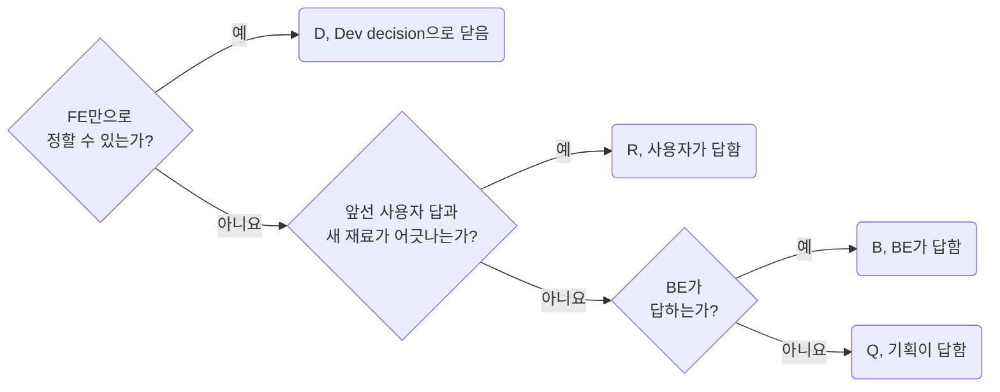

## Keep Every Number in One Page

**Impact: CRITICAL (같은 질문이 문서마다 다른 번호로 흩어져 답이 어디에 있는지 찾아다니는 일을 없앱니다)**

결정과 질문은 전부 `questions.md` 한 문서에 삽니다. 번호는 답하는 사람으로 가릅니다.

| 번호 | 뜻 | 답하는 사람 |
| --- | --- | --- |
| D | 개발 결정 | 개발자. Dev decision으로 닫습니다 |
| Q | 기획과 디자인 질문 | 기획 |
| B | BE 질문 | BE |
| R | 다시 정할 것. 앞선 답과 새 재료가 어긋난 것 | 사용자 |

`questions.md`는 화면마다 `##` 절을 두고 질문마다 `### Q3`처럼 번호만으로 소제목을 답니다.
번호 소제목 하나와 그 아래 줄을 카드라 부릅니다.
제목이 번호 하나라 슬러그가 `q3`로 안정됩니다.
화면 문서는 번호 글자에 `../questions.md#q3` 주소를 건 링크로 가리킵니다.
질문 한 줄은 소제목 바로 아래 첫 줄에 굵게 씁니다. 풀린 카드는 절 끝의 접힌 `Resolved` 표로 내립니다.

번호는 프로젝트 안에서 하나입니다. 지운 번호는 다시 쓰지 않습니다. 화면 문서 안에 카드를 두지 않습니다.
화면 문서의 Decisions 절은 큰 결정 셋만 한 줄씩 결정 글로 적고 번호는 링크 없이 글로 둡니다.
풀린 카드는 소제목이 지워져 링크가 끊기기 때문입니다.

**Incorrect 1 (화면 문서마다 카드를 두어 같은 번호가 두 문서에 생깁니다):**

<<< ../examples/question-keep-every-number-in-one-page/01-incorrect-1.markdown [screen/orders.md]

<<< ../examples/question-keep-every-number-in-one-page/01-incorrect-2.markdown [screen/customer-detail.md]

**Correct 1 (questions.md의 화면 절에 번호 소제목을 두고 화면 문서는 링크로 가리킵니다):**

<<< ../examples/question-keep-every-number-in-one-page/02-correct-1.markdown [questions.md]

<<< ../examples/question-keep-every-number-in-one-page/02-correct-2.markdown [screen/orders.md]
