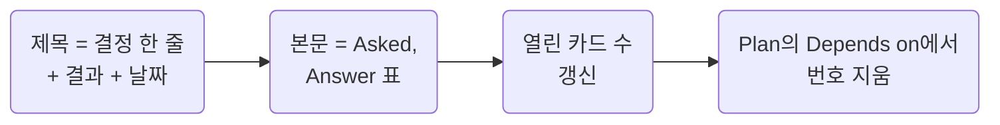

## Close Cards in Place with the Result

**Impact: CRITICAL (풀린 질문의 링크가 끊기지 않고 결정과 질문이 두 절에 겹쳐 적히지 않게 합니다)**

질문이 풀리면 카드를 지우지 않고 같은 자리에서 닫힌 꼴로 고쳐 씁니다. 앵커가 남아 본문의 번호 링크가 그대로 통합니다.

| 자리 | 닫힌 꼴 |
| --- | --- |
| 제목 줄 | `:::details[Q1 환불 주문 = 포함, 상태 칩으로 구분 As recommended 2026-10-07]`. 질문 대신 결정 한 줄 |
| 본문 | `Asked`, `Answer` 표 한 줄. 무엇을 물었고 무엇으로 정했는지 |
| 순서 | 열린 카드 아래 |

| 결과 | 뜻 |
| --- | --- |
| `As recommended` | 추천대로 |
| `Per Figma`, `Per demo`, `Per spec`, `Per capture` | 그 재료대로 |
| `Dev decision` | 개발이 정함 |
| `User` | 사용자가 정함 |
| `Done` | 했음 |
| `Kept` | 지금대로 |
| `Rejected` | 하지 않음 |
| `N/A` | 질문이 성립하지 않음 |
| `Moved` | 다른 화면이나 변경 문서로 |

재료가 정하지 않았고 다른 선택지가 실제로 있던 갈림길만 질문 없이 정했어도 처음부터 닫힌 D 카드로 씁니다.
재료대로 따른 것은 카드가 아니라 부분 표나 규칙 표의 한 줄입니다.
화면 문서에 결정만 모으는 절을 따로 두지 않습니다.
같은 결정이 닫힌 카드와 본문 규칙 표에 함께 있으면 본문은 규칙만, 카드는 갈림길과 출처만 남깁니다.
결과 뒤 날짜는 `YYYY-MM-DD`입니다. 연도를 빼면 알약과 날짜가 갈라져 보입니다.
새 재료가 사용자가 앞서 답한 것과 어긋나면 그 답을 뒤집지 않고 `R` 카드로 올립니다.
이유와 경위는 `Answer` 칸 한 줄과 변경 문서, git에 둡니다.

참고: [Michael Nygard: 아키텍처 결정 문서화](https://cognitect.com/blog/2011/11/15/documenting-architecture-decisions),
[MADR: 결정 기록 템플릿](https://adr.github.io/madr/).

**Incorrect 1 (풀린 카드를 지우고 결정만 따로 모아 같은 결정이 두 절에 적히고 번호 링크가 끊깁니다):**

<<< ../examples/question-close-cards-in-place-with-the-result/01-incorrect.markdown

**Correct 1 (풀린 것은 그 자리의 닫힌 카드로, 질문 없이 정한 것은 D 카드로, 어긋난 옛 답은 R 카드로 남깁니다):**

<<< ../examples/question-close-cards-in-place-with-the-result/02-correct.markdown
