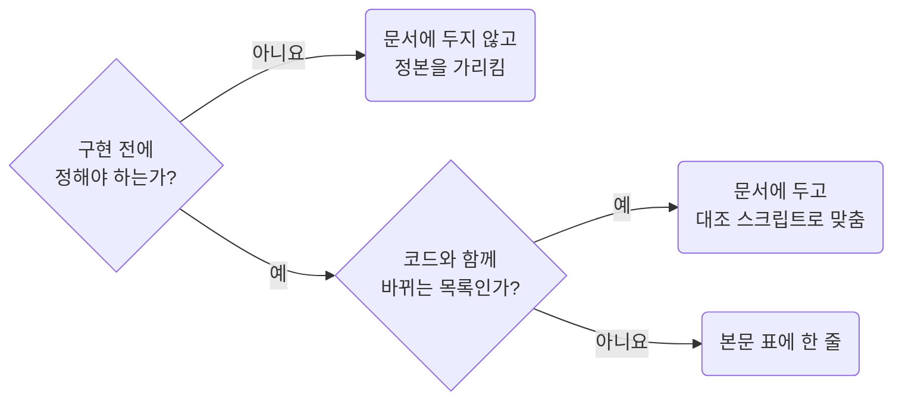

## Keep Code-Owned Values Out of the Doc

**Impact: HIGH (코드와 문서를 둘 다 고쳐야 하는 일과 접힌 절 뒤에 숨은 비대한 문서를 막습니다)**

문서에는 구현 전에 정해야 하는 것만 펼쳐 둡니다. 코드가 생긴 뒤 그 값의 정본이 코드인 것은 문서에 베끼지 않습니다.

| 두는 것 | 두지 않는 것 | 그 정보의 정본 |
| --- | --- | --- |
| 폭 급, 정렬, 자리 | CSS 실측 값 | 스타일시트 |
| 응답 필드, 주소 key, 값 규칙 | 더미 데이터와 mock 값 | mock 폴더 |
| mock의 출처와 덮는 경우 | mock 파일의 줄 | mock 폴더 |
| 시나리오 ID와 문장 | 테스트 코드 | 테스트 폴더. 대조 스크립트가 문서와 맞춤 |
| 코드 나무와 한 줄 주석 | 파일 내용 | 소스 |
| — | 개정 이력, 작업 경위 | git과 변경 문서 |
| — | 읽은 노드 전체 표 | `Sources` 절의 몇 줄 |

구현 상세를 `:::details`로 접지 않습니다. 한두 줄을 접으면 뜻이 안 보이고 긴 것을 접으면 길이의 핑계가 됩니다.
접는 것은 질문 카드 하나하나와 `Sources` 절뿐입니다. `Sources`는 `{open}`으로 펼쳐 둡니다.
구현이 끝나면 문서는 화면 동작을 찾아보는 자료가 됩니다.
그때 위 표의 두지 않는 것이 남아 있으면 지웁니다.
두는 것은 지우지 않습니다.

**Incorrect 1 (CSS 실측 값과 mock 값을 접어 두어 코드와 문서를 둘 다 고쳐야 합니다):**

<<< ../examples/structure-keep-code-owned-values-out/01-incorrect.markdown

**Correct 1 (자리와 규칙, mock의 출처와 경우만 펼쳐 두고 값은 정본을 가리킵니다):**

<<< ../examples/structure-keep-code-owned-values-out/02-correct.markdown
