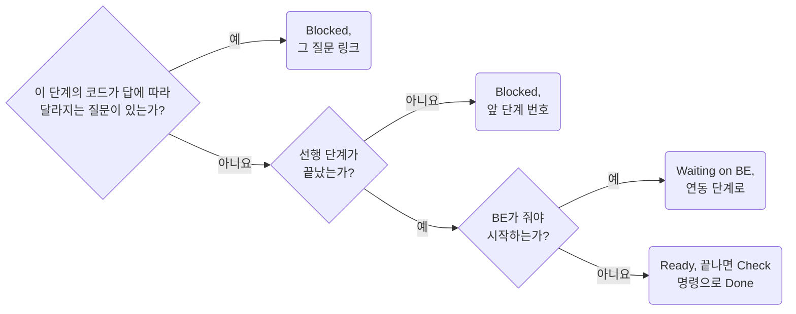

## Split Work into Gated Stages

**Impact: HIGH (어느 단계를 지금 시작할 수 있고 무엇이 막는지 한 표로 보이게 합니다)**

구현은 화면 문서 머리의 `Plan` 절에 단계 표로 나눕니다. 구현 전에는 계획, 구현 중에는 진행표입니다.
단계마다 끝났음을 보이는 확인 명령 하나를 두고 기다리는 질문이 있으면 그 링크를 둡니다.

| 단계 | 내용 |
| --- | --- |
| 0 준비 | 부품 승격, 새 ui 부품, 동작 확인용 임시 코드 |
| 1부터 | 화면 구역 하나씩. 지금 spec 위 mock으로 |
| 연동 | BE가 주는 대로 spec 재생성, 깨진 곳 수정, 숨긴 열 보이기 |
| 검증 | 테스트, 캡처 대조, 사용자 확인 |

표의 칸은 `Stage`, `Work`, `Depends on`, `Check`, `Status`입니다.
`Blocked by`처럼 상태 어휘가 든 머리는 배지로 바뀌므로 쓰지 않습니다.

| 칸 | 쓰는 법 |
| --- | --- |
| `Depends on` | 그 단계의 코드가 답에 따라 달라지는 질문 번호 링크. 여러 단계를 막으면 가장 이른 단계에. 선행 단계가 안 끝났으면 그 단계 번호 |
| `Check` | 끝났음을 보이는 명령 하나 |
| `Status` | `Ready`, `Blocked`, `Waiting on BE`, `Done YYYY-MM-DD`. 선행 단계가 안 끝났으면 `Blocked` |

BE 대기는 막는 것으로 세지 않고 연동 단계에 둡니다.
단계 표 아래에 열린 질문 수, 막는 단계, `Questions` 절 링크를 한 줄로 둡니다.
FE 코드가 0줄인 확인 거리와 BE가 줄 필드는 필요할 때만 표 아래 `### Follow-up`, `### Expected from BE`로 둡니다.

**Incorrect 1 (관문 없는 할 일 목록이라 무엇부터 시작할 수 있는지 알 수 없습니다):**

<<< ../examples/stage-split-work-into-gated-stages/01-incorrect.markdown

**Correct 1 (단계마다 막는 질문과 확인 명령을 둔 표입니다):**

<<< ../examples/stage-split-work-into-gated-stages/02-correct.markdown
