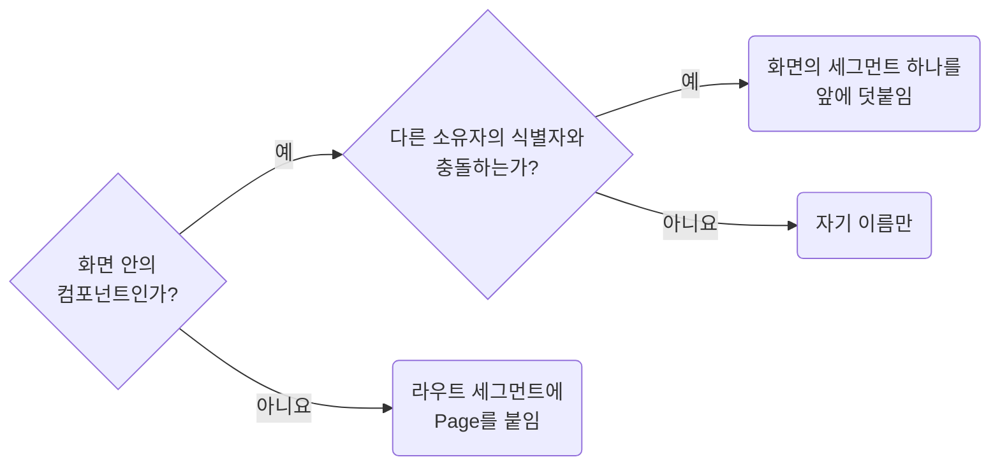

## Keep Page Slugs Traceable to Their Screen

**Impact: MEDIUM (클래스 이름에서 해당 화면을 추적할 수 있습니다)**

`page` 아래 CSS 파일의 식별자에는 어느 화면인지 추적할 수 있는 이름을 씁니다.
화면 소유 여부는 활성화된 프레임워크 규약이 정하고 CSS는 그 이름을 따릅니다.

| 대상 | 식별자 |
| --- | --- |
| 라우트 진입 파일 | 라우트 세그먼트나 폴더 이름에 `Page`를 붙인 진입 컴포넌트 이름입니다. `shell`, `content`처럼 어느 화면에나 붙는 낱말은 쓰지 않습니다 |
| `Outlet` 프레임 | 활성화된 프레임워크 규약이 정한 진입 파일 이름을 씁니다. `root-outlet.tsx`는 `rootOutlet`, `main-outlet.tsx`는 `mainOutlet`입니다 |
| `:id`처럼 값이 런타임에 정해지는 동적 세그먼트 | 화면의 역할로 바꿉니다. `orders/:id`라면 라우트 폴더는 `order-detail`, 식별자는 `orderDetailPage`입니다 |
| 화면 안의 컴포넌트 | 자기 이름만 씁니다 |

라우트 경로나 폴더 이름에 없는 줄임말은 쓰지 않고, 덧붙일 때 중간 컴포넌트 이름은 넣지 않습니다.

**Incorrect 1 (화면 이름이 아닌 식별자를 씁니다):**

<<< ../examples/naming-keep-page-slug-traceable/01-incorrect.txt

**Correct 1 (라우트 진입 파일에는 라우트 세그먼트에 `Page`를 붙여 씁니다):**

<<< ../examples/naming-keep-page-slug-traceable/02-correct.txt

**Incorrect 2 (충돌이 없는데도 부모 식별자를 미리 붙입니다):**

<<< ../examples/naming-keep-page-slug-traceable/03-incorrect.txt

**Correct 2 (화면 안의 컴포넌트는 자기 식별자만 씁니다):**

<<< ../examples/naming-keep-page-slug-traceable/04-correct.txt

**Incorrect 3 (충돌을 피하려고 상위 경로 전체를 식별자에 붙입니다):**

<<< ../examples/naming-keep-page-slug-traceable/05-incorrect.txt

**Correct 3 (충돌한 화면 이름만 최소로 덧붙입니다):**

<<< ../examples/naming-keep-page-slug-traceable/06-correct.txt
