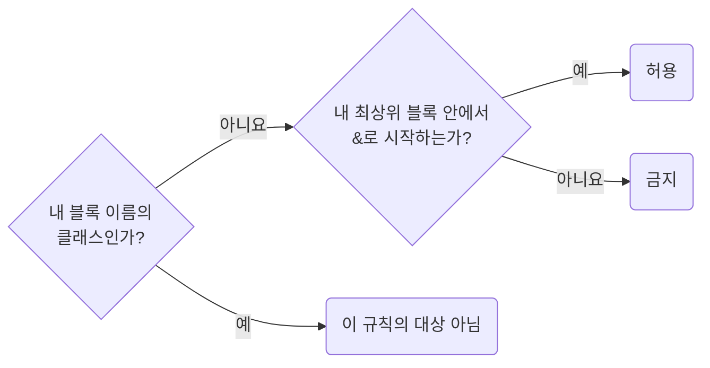

## Use Foreign Classes Only Under Your Own Root

**Impact: CRITICAL (다른 소유자의 스타일을 덮어써도 해당 인스턴스에만 적용되도록 제한합니다)**

### 선택자 판정

다른 소유자의 클래스는 **내 최상위 클래스 블록 안에서 `&`로 시작하는 선택자**로만 씁니다.
내 블록 이름이 아니면 외부 라이브러리, 다른 화면, `widget` 모두 같은 기준을 적용합니다.

| 선택자 | 판정 |
| --- | --- |
| `.MuiTreeItem-label { }` | 금지. 그 라이브러리를 쓰는 앱 전체에 적용됩니다 |
| `.chartCard__caption { }` | 금지. 화면 CSS에 두면 그 `widget`을 쓰는 모든 화면에 적용됩니다 |
| `.productsPage__sidebar { & .MuiTreeItem-label { } }` | 허용. 해당 인스턴스에만 적용됩니다 |
| `.productDetailPage__root { & .chartCard__caption { } }` | 허용. 다만 `ownership-change-other-owners-through-their-api`의 세 방법이 맞지 않을 때만입니다 |
| `.productsPage__sidebar .MuiTreeItem-label { }` | 금지. 최상위 블록 안에서 `&`로 시작해야 합니다 |
| `.productsPage__sidebarToolbar .productsPage__sidebarTitle { }` | 같은 소유자의 클래스끼리라 이 규칙의 대상이 아닙니다 |

다른 소유자의 DOM 경로는 우리가 정하지 않으므로 결합자 개수를 제한하지 않습니다.
블록 중첩 깊이는 `selector-limit-nesting-block-depth`를 따릅니다.
직접 수정할 수 있는 클래스라면 `ownership-change-other-owners-through-their-api`의 세 방법을 먼저 확인합니다.
세 방법이 모두 맞지 않을 때 이 규칙을 적용합니다.

### 기계 검사 범위

`selector-disallowed-list`는 등록된 외부 라이브러리 접두사로 시작하는 최상위 선택자만 검사합니다.
다른 소유자의 블록 이름은 문법이 같아 이 검사에 걸리지 않으므로 리뷰에서 파일 이름과 블록 이름을 대조합니다.

참고: [MUI 문서: 중첩 요소와 상태 클래스를 덮어쓰는 방법](https://mui.com/material-ui/customization/how-to-customize/),
[stylelint selector-disallowed-list](https://stylelint.io/user-guide/rules/selector-disallowed-list/).

**Incorrect 1 (최상위 블록 없이 라이브러리 클래스를 바로 씁니다):**

<<< ../examples/ownership-use-foreign-classes-only-under-your-own-root/01-incorrect.css

**Correct 1 (내 최상위 블록 안에서 외부 라이브러리 DOM을 선택자로 잡습니다):**

<<< ../examples/ownership-use-foreign-classes-only-under-your-own-root/02-correct.css

**Incorrect 2 (최상위 블록 없이 다른 소유자의 클래스를 바로 씁니다):**

<<< ../examples/ownership-use-foreign-classes-only-under-your-own-root/03-incorrect.css

**Correct 2 (다른 소유자의 클래스도 내 최상위 블록 안에서 선택자로 잡습니다):**

<<< ../examples/ownership-use-foreign-classes-only-under-your-own-root/04-correct.css

**Incorrect 3 (최상위 블록을 열지 않고 바깥에서 이어 씁니다):**

<<< ../examples/ownership-use-foreign-classes-only-under-your-own-root/05-incorrect.css

**Correct 3 (소유자 API로 해결할 수 없으면 내 최상위 블록 안에서 선택합니다):**

<<< ../examples/ownership-use-foreign-classes-only-under-your-own-root/06-correct.css
