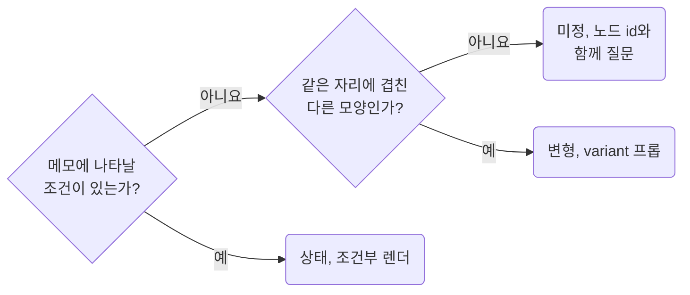

## Collect Hidden Layers and Annotations Before Building

**Impact: HIGH (한 화면에 겹쳐 둔 상태와 요구 조건이 구현에서 빠지지 않고 버린 초안이 화면에 올라가지도 않습니다)**

숨긴 레이어와 메모는 구현 전에 아래 차례로 분류해 상태 목록으로 모읍니다.
숨긴 레이어는 대개 디자이너가 상태나 변형을 한 화면에 겹쳐 둔 흔적입니다.
보이는 것만 구현하면 상태가 빠집니다.
숨긴 것까지 모두 보이게 구현하면 버린 초안이 화면에 올라갑니다.

| 발견한 것 | 분류 | 처리 |
| --- | --- | --- |
| 조건에 따라 나타날 요소. 선택 칩, 초기화 버튼, 툴팁 | 상태 | 조건부 렌더로 구현하고 조건은 메모에서 찾습니다 |
| 같은 자리에 겹친 다른 모양 | 변형 | 컴포넌트의 `variant`나 프롭으로 옮깁니다 |
| 조건을 알 수 없는 숨긴 요소 | 미정 | 구현하지 않고 노드 id와 함께 질문합니다 |
| 메모 본문 | 요구 조건 | 정렬 기준, 노출 기간, 제외 조건을 목록에 적습니다 |
| 변경 이력 표 | 요구 조건 | 목록에 적습니다. 화면과 다르면 `intent-ask-when-ux-notes-and-gui-disagree`를 따릅니다 |
| 설계 문서의 재료로 읽은 메모, 댓글, 미정 요소 | 질문 후보 | 코드로 옮기지 않고 설계 문서의 질문 목록으로 넘깁니다 |

메모와 이력의 글자는 `get_metadata`의 `text` 노드 `name`으로 위치만 찾습니다.
요구 조건으로 적기 전에 그 메모 프레임에 `get_screenshot`을 한 번 부릅니다.
스크린샷으로도 안 읽히면 그 메모 프레임만 `get_design_context`로 읽습니다.
메모와 화면이 어긋날 때의 처리는 `intent-ask-when-ux-notes-and-gui-disagree`가 정합니다.

참고: [Figma 도움말: 측정값과 주석](https://help.figma.com/hc/en-us/articles/20774752502935),
[Figma 문서: 코드를 위한 파일 구조](https://developers.figma.com/docs/figma-mcp-server/structure-figma-file/).

**Incorrect 1 (보이는 레이어만 구현 목록에 올립니다):**

<<< ../examples/read-collect-hidden-layers-and-annotations/01-incorrect.txt

**Correct 1 (숨긴 레이어와 메모를 분류해 상태 목록을 함께 만듭니다):**

<<< ../examples/read-collect-hidden-layers-and-annotations/02-correct.txt
