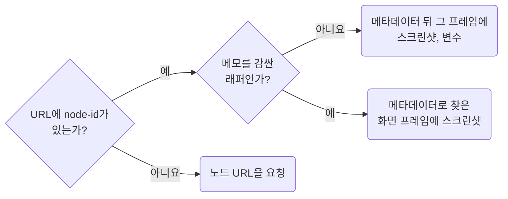

## Choose the Node Each Tool Reads

**Impact: HIGH (같은 비용으로 화면 글자와 메모를 놓치지 않고 읽습니다)**

스크린샷은 화면 프레임에, 메타데이터는 메모 래퍼에 부릅니다.
공유받은 URL은 화면 하나가 아니라 화면과 메모, 변경 이력을 함께 감싼 래퍼를 가리킬 때가 많습니다.
래퍼를 스크린샷으로 찍으면 화면의 글자가 읽히지 않습니다.
화면 프레임에 메타데이터를 부르면 옆에 붙은 메모와 이력을 놓칩니다.

### 노드별 도구

| 노드 | 메타데이터에서 알아보는 법 | 부를 도구 |
| --- | --- | --- |
| 메모 래퍼 | 화면 프레임, 메모 프레임, 이력 표를 형제로 품은 바깥 `frame` | `get_metadata` |
| 화면 프레임 | 1920, 1440, 375 같은 기기 폭이고 GNB 같은 공통 인스턴스를 품은 `frame` | `get_screenshot`, `get_variable_defs` |
| 반복 단위, 컴포넌트 | 같은 `name`과 크기로 여러 번 나오는 `frame`, `instance` | `read-call-design-context-only-on-small-unmatched-nodes`가 정합니다 |
| 라이브러리 master set | `Size=Medium, State=Default` 같은 이름의 자식 variant가 여럿인 노드 | `get_screenshot`은 set 하나, `get_metadata`는 variant 하나, 속성 축과 variant id는 읽기 전용 `use_figma` |

래퍼 id만 받았으면 메타데이터에서 화면 프레임 id를 찾아 스크린샷을 그 id로 부릅니다.
화면 프레임이 둘 이상이면 요청이 가리키는 상태의 프레임을 고릅니다.
나머지는 상태 목록에 적습니다.
래퍼의 첫 응답으로 노드 수×35가 예산을 넘는다고 알게 되면 이후에는 래퍼 대신 화면 프레임과 메모 프레임에 따로 부릅니다.
master set은 노드 수가 variant 수에 비례해 늘어 set 전체에 `get_metadata`를 부르면 예산을 넘기 쉽습니다.
variant 135개 set이 그 예입니다.
속성 축과 variant id는 `use_figma`로 `componentPropertyDefinitions`와 `children`의 `name`, `id`를 읽어 얻습니다.

### URL 읽기

| URL, 노드 id | 처리 |
| --- | --- |
| `node-id=1-2` | 노드 id는 `1:2`입니다 |
| `/design/:fileKey/branch/:branchKey/` | `branchKey`를 `fileKey`로 씁니다 |
| `/file/:fileKey/` | `/design/:fileKey/`와 같게 봅니다 |
| 화면 프레임 하나를 가리킴 | 그 프레임에 `get_metadata`를 불러 숨긴 레이어와 자손 수를 읽습니다. 옆의 메모와 이력은 이 URL로 찾을 수 없으므로 보고에 적고 래퍼 URL을 요청합니다 |
| `node-id`가 없음 | 추측하지 않고 노드 URL을 요청합니다. `get_metadata`를 노드 없이 부르면 페이지 목록만 옵니다 |
| 인스턴스 안쪽 노드 id `I12:34;56:78` | `get_metadata`와 `get_design_context`만 받습니다. 다른 도구에는 그 인스턴스 자체의 id를 넘깁니다 |

참고: [Figma: get_metadata](https://developers.figma.com/docs/figma-mcp-server/tools-and-prompts/#get_metadata).

**Incorrect 1 (래퍼에 스크린샷을 불러 화면이 메모와 함께 줄어듭니다):**

<<< ../examples/read-choose-the-node-each-tool-reads/01-incorrect.txt

**Correct 1 (메타데이터로 화면 프레임을 찾아 그 프레임만 찍습니다):**

<<< ../examples/read-choose-the-node-each-tool-reads/02-correct.txt
