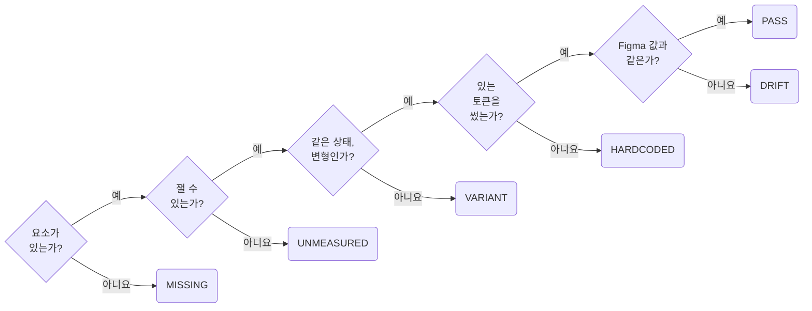

## Measure Rendered Values Before Claiming Parity

**Impact: HIGH (눈으로 대조해서는 놓치는 간격, 색, 빠진 상태를 수치로 확인하고 보고합니다)**

스크린샷을 눈으로 대조하면 1px 간격, 비슷한 회색, 빠진 상태를 놓칩니다.
실제 라우트에서 렌더 값을 읽어 대조 행마다 견줍니다.
수치로 확인한 행만 일치로 보고합니다.
무엇을 확인할지는 작업 종류가 정합니다.

| 작업 | 확인 |
| --- | --- |
| 구현. 코드를 바꿈 | 재는 차례와 판정을 따릅니다 |
| 라이브러리 구성. Figma 라이브러리 파일에 씀 | 라이브러리 검사를 따릅니다. 렌더 값은 재지 않습니다 |
| 둘 다 | 둘 다 합니다 |
| 읽기만 함. 코드도 Figma도 바꾸지 않음 | 잴 값이 없습니다. 보고에 측정 대상 없음을 적고 끝냅니다 |

### 재는 차례

1. 대조 행을 만듭니다.
   요소, 속성, 기대 값을 한 행에 두고 토큰이 있으면 그 이름도 적습니다.
   행은 이번 변경이 새로 만들거나 바꾼 요소의 속성 가운데 Figma에서 옮긴 값에만 만듭니다.
   설계 문서가 있는 화면은 그 문서가 Figma에서 옮기기로 적은 항목만 행으로 만듭니다.
   문서가 프로젝트 기본값에 맡긴 안쪽 간격, 글꼴 크기, 모서리 반경, 그림자는 행으로 만들지 않습니다.
   Figma 쪽 값을 `get_variable_defs`나 이미 받은 응답에서 얻지 못한 행은 `UNMEASURED`로 두고 보고에 남깁니다.
   그 행에는 `PASS`, `DRIFT`를 붙이지 않습니다.
   에셋은 로컬 파일이 비어 있지 않은지, 렌더 폭과 높이가 Figma 비율과 맞는지도 행으로 둡니다.
2. 실제 라우트를 열고 `getComputedStyle`, `getBoundingClientRect`로 값을 읽습니다.
3. 행마다 판정을 붙입니다.
4. 요청 범위 안의 차이만 고치고 다시 잽니다.
   범위 밖 차이는 고치지 않고 보고합니다.
   세 번 돌면 멈추고 남은 행은 그대로 보고합니다.

값은 브라우저 자동화 도구의 페이지 평가로 읽습니다.
브라우저 스크린샷을 Figma 스크린샷 옆에 두고 배치와 누락을 봅니다.
이 대조가 수치 판정을 대신하지는 않습니다.

### 판정

| 판정 | 뜻 |
| --- | --- |
| `PASS` | 렌더 값이 기대 값과 같고 그 값이 Figma 값과도 같습니다 |
| `DRIFT` | 토큰은 맞게 썼지만 토큰 값이 Figma 값과 다릅니다 |
| `HARDCODED` | 같은 용도의 프로젝트 토큰이 있는데 값을 직접 썼습니다 |
| `VARIANT` | 상태나 변형이 달라 비교 대상이 아닙니다. `DRIFT`보다 먼저 판정합니다 |
| `MISSING` | 요소나 상태가 화면에 없습니다 |
| `UNMEASURED` | 브라우저 쪽이나 Figma 쪽 값을 얻을 수단이 없어 재지 못했습니다. 이 행은 일치로 보고하지 않고 사람이 잴 수 있게 요소와 속성을 보고에 남깁니다 |

판정 어휘는 jeltehomminga/figma-design-skills의 `design-fidelity-verify`(MIT)에서 가져왔습니다.

### 라이브러리 검사

라이브러리 파일을 고쳤으면 읽기만 하는 `use_figma` 스크립트로 바뀐 페이지의 위반을 셉니다.
위반이 0이 될 때까지 고칩니다.
바뀐 섹션마다 `get_screenshot`을 찍어 Storybook의 같은 story와 나란히 놓고 정렬, 잘림, 겹침, 색을 봅니다.

| 검사 | 위반 | 규칙 |
| --- | --- | --- |
| 페이지 이름 | 기호 없는 이름, 이모지 | `file-mark-each-page-kind-with-one-symbol` |
| master 깊이 | 섹션 바로 아래가 아닌 master, master 없는 섹션 | `layer-put-masters-directly-under-the-section` |
| 레이어 이름 | `Frame 12` 같은 기본 이름, 가운뎃점 | `layer-name-layers-by-role` |
| 묶이지 않은 값 | 변수에 묶이지 않은 칠하기와 테두리, 글자 스타일 없는 글자 | `variable-bind-visual-values-to-variables-and-styles` |
| 속성 순서 | 종류 → `Size` → 내용 → `State`가 아닌 속성, 어긋난 `Size`, `State` 값 순서 | `property-share-axis-names-values-and-order` |
| 노트 | 작성자나 날짜가 없는 노란 노트 | `note-sign-dated-notes-and-remove-them-when-settled` |
| master 설명 | 설명이 없는 master | `note-describe-masters-with-purpose-and-code-path` |

참고: [Figma 문서: 사용자 지정 규칙](https://developers.figma.com/docs/figma-mcp-server/add-custom-rules/#output-rules),
[MDN: getComputedStyle()](https://developer.mozilla.org/en-US/docs/Web/API/Window/getComputedStyle),
[MDN: getBoundingClientRect()](https://developer.mozilla.org/en-US/docs/Web/API/Element/getBoundingClientRect).

**Incorrect 1 (눈으로 대조한 결과를 일치로 보고합니다):**

<<< ../examples/verify-measure-rendered-values-before-claiming-parity/01-incorrect.txt

**Correct 1 (렌더 값을 행마다 재고 판정을 붙입니다):**

<<< ../examples/verify-measure-rendered-values-before-claiming-parity/02-correct.txt

**Correct (라이브러리만 고친 작업은 렌더 값 대신 검사 위반과 섹션 대조를 남깁니다):**

<<< ../examples/verify-measure-rendered-values-before-claiming-parity/03-correct.txt
