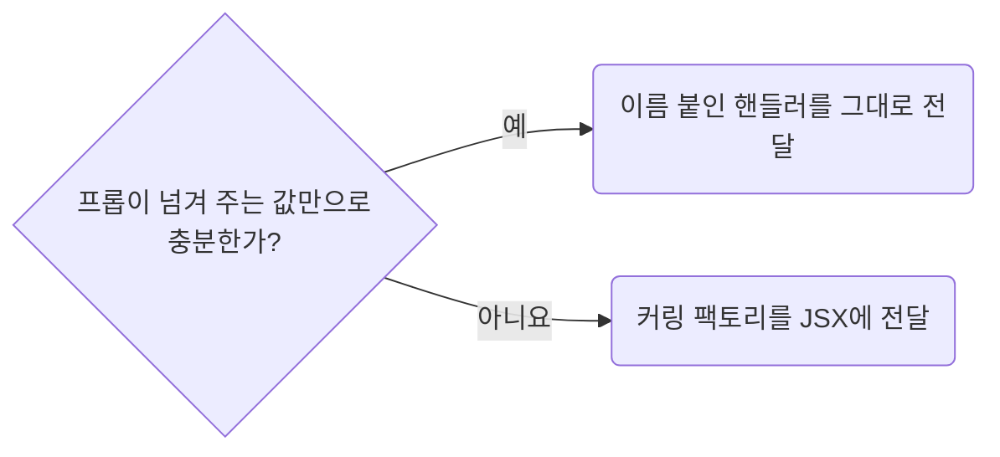

# Curry Extra Arguments Into DOM Event Handlers

**Impact: MEDIUM (추가 인자 전달만을 위한 JSX 인라인 래퍼를 줄입니다)**

콜백 프롭이 넘겨 주는 값만으로 모자라 호출부의 값(목록 항목, `id`)이 더 필요하면 커링합니다.
팩토리가 호출부의 값을 받고 안쪽 함수가 프롭이 넘겨 주는 인자를 받습니다.
반환한 함수는 JSX에 직접 전달합니다.



| 작성할 부분 | 기준 |
| --- | --- |
| 프롭이 넘겨 주는 값만으로 충분함. 이벤트 객체, `(id) => void`의 `id`가 그 예 | 커링하지 않고 이름 붙인 핸들러를 그대로 넘깁니다 |
| 호출부의 값이 더 필요함. 이벤트를 받지 않는 `() => void` 프롭도 같음 | 커링 팩토리를 넘깁니다. `onRemove={handleProductRemove(product.id)}` |
| 팩토리 이름 | 커링 없는 핸들러처럼 `handle*`을 씁니다. 호출 인자로 용도를 알 수 있으므로 `With<인자>`는 붙이지 않습니다 |
| 반환 타입 | `typing-take-handler-types-from-existing-contracts`에 따라 React 별칭이나 `<래퍼 이름>Props`의 프롭 타입을 씁니다 |
| 함수 형태 | 화살표 두 단계로 적습니다. 안쪽 함수에 별도 이름을 붙여 반환하지 않습니다 |
| 반환 전 준비 계산이 있음 | 이때만 바깥 블록 본문을 엽니다. 반환하는 화살표는 이름을 붙이지 않습니다 |
| `useEffectEvent` 반환 함수 | DOM 이벤트 매개변수나 커링을 덧붙이지 않습니다. JSX 이벤트 프롭에 넘길 수 없는 함수입니다(`state-use-effectevent-for-non-reactive-effect-callbacks`) |

**Requires selected:** `typing-take-handler-types-from-existing-contracts` (함께 적용)

**Incorrect 1 (인라인 래퍼로 인자를 넘깁니다):**

```tsx
<Button onClick={(_event) => handleListItemClick(product.id)}>{product.name}</Button>;
```

**Correct 1 (JSX에는 팩토리 호출만 두고 감싸는 화살표를 만들지 않습니다):**

```tsx
<Button onClick={handleListItemClick(product.id)}>{product.name}</Button>;
```

> 나머지 예시와 예외는 [full rule](../rules/09-02-events-curry-extra-handler-arguments.md)에 있습니다.
