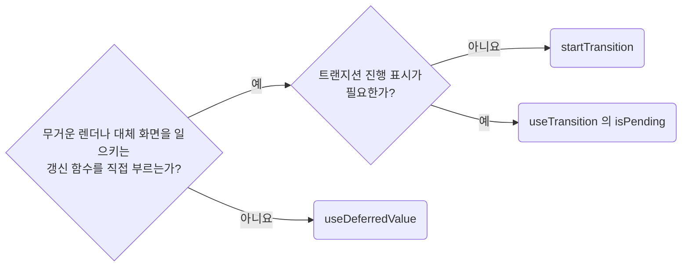

# Defer Heavy Renders Only With Measured Evidence

**Impact: MEDIUM (측정한 렌더 병목과 `Suspense` 키 갱신에만 트랜지션과 지연 값을 적용합니다)**

`startTransition`, `useTransition`, `useDeferredValue`는 렌더 비용을 측정한 뒤 사용합니다.
목록 행 수와 조작별 소요 시간을 확인합니다.
예상 규모만 근거로 삼지 않습니다.
`Suspense` 쿼리의 키를 바꾸는 갱신만 예외이며 측정 없이 `startTransition`으로 감쌉니다.

### 지연 도구 고르기



| 상황 | 선택 |
| --- | --- |
| 직접 호출하는 상태 갱신이 무거운 렌더를 일으킴 | `startTransition`으로 호출을 감쌉니다. 프롭으로 받은 갱신 함수도 같습니다 |
| 값은 즉시 반응해야 하지만 파생 렌더는 미룰 수 있음 | `useDeferredValue`로 지연 값을 만듭니다 |
| `Suspense` 쿼리의 키를 바꾸는 갱신으로 이미 보인 내용물이 대체 화면으로 바뀜 | 측정 없이 `startTransition`으로 감쌉니다. search 파라미터를 nuqs로 바꾸면 `setUrlParams` 호출을 직접 감쌉니다. 진행 표시는 `useTransition`의 `isPending`입니다 |
| 갱신 함수를 호출할 수 없고 프롭, 훅 반환값만 받음 | `useDeferredValue`를 씁니다 |
| 트랜지션 진행 표시가 필요함 | 대기 상태를 주지 않는 `startTransition` 대신 `useTransition`의 `isPending`을 씁니다 |

입력값 자체, 폼 오류, 즉시 비활성화 같은 급한 반응은 트랜지션에 넣지 않습니다.
`await` 뒤에는 React가 트랜지션 문맥을 이어 가지 못하므로 상태 갱신을 다시 `startTransition`으로 감쌉니다.
nuqs의 `startTransition` 옵션은 `shallow: false` 갱신이 서버나 로더를 기다리는 동안의 진행 표시용입니다.
훅 자신의 상태 갱신은 감싸지 않습니다.
옵션만 넘기면 `isPending`만 바뀌고 대체 화면은 그대로 나옵니다.

### 최적화 조건

| 무거운 작업 | 최적화 조건 |
| --- | --- |
| 하위 트리 렌더 | 같은 프롭이면 렌더를 건너뛸 수 있어야 합니다. 컴파일러가 이를 제공하지 않으면 지연 값을 받는 컴포넌트를 `memo`로 감쌉니다 |
| 함께 전달하는 객체, 콜백 | 매번 달라지면 `memo`가 있어도 다시 렌더되므로 참조를 확인합니다 |
| 지연 값에서 파생되는 계산 | 컴포넌트 `memo` 대신 `useMemo`로 지연 값이 바뀔 때만 재계산합니다. 측정 근거를 주석으로 남깁니다 |

`startTransition`의 콜백은 즉시 실행되며 안쪽의 무거운 동기 계산이나 네트워크 요청 자체를 미루지 않습니다.
`useDeferredValue`는 고정 지연 시간이 없고 요청 횟수를 줄이는 디바운스도 아닙니다.

참고: [React 문서: useTransition](https://react.dev/reference/react/useTransition),
[React 문서: useDeferredValue](https://react.dev/reference/react/useDeferredValue),
[nuqs 문서: 옵션의 Transitions](https://nuqs.dev/docs/options),
[TanStack Query 문서: Suspense](https://tanstack.com/query/latest/docs/framework/react/guides/suspense).

**Incorrect 1 (행 20개 목록을 다시 렌더하는 갱신까지 트랜지션으로 감쌉니다):**

```tsx
const [selectedCategoryId, setSelectedCategoryId] = useState("all");
const categoryRows = responseCategoryListSuspense.data.categories.slice(0, 20);

const handleCategoryClick = (nextCategoryId: string) => {
	startTransition(() => {
		setSelectedCategoryId(nextCategoryId);
	});
};

return <CategoryRows rows={categoryRows} selectedCategoryId={selectedCategoryId} />;
```

**Correct 1 (측정 근거가 있는 갱신만 트랜지션으로 감싸고 행 20개 목록은 그대로 둡니다):**

```tsx
const handleCategoryClick = (nextCategoryId: string) => {
	setSelectedCategoryId(nextCategoryId);
};

const handleStatusFilterChange = (nextStatus: ProductStatusFilter) => {
	// 행 12,000개에서 필터 전환 320ms 측정, 클릭 지연
	startTransition(() => {
		setStatusFilter(nextStatus);
	});
};
```

> 나머지 예시와 예외는 [full rule](../rules/10-03-perf-defer-heavy-renders-with-measured-evidence.md)에 있습니다.
