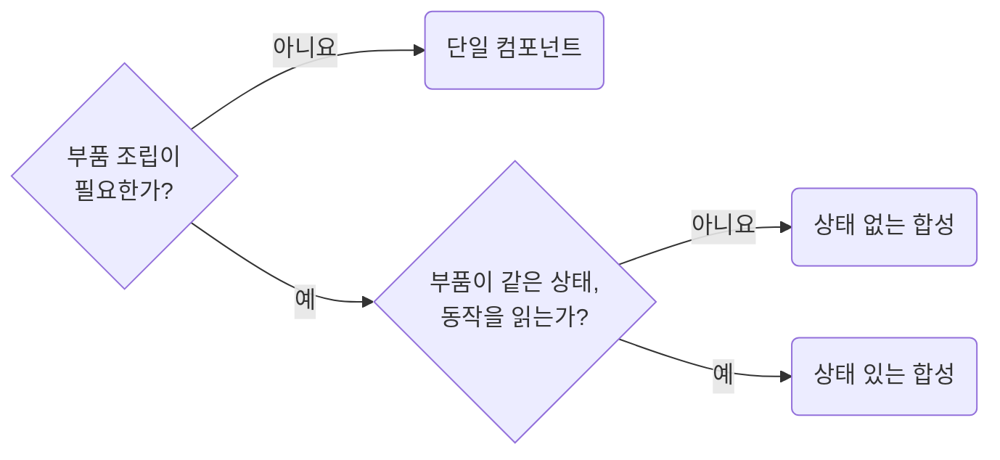

# Choose Single Components, Compound Components, and Variants Deliberately

**Impact: MEDIUM (필요한 확장 범위에 맞춰 단순한 컴포넌트 구조를 선택합니다)**

공용 컴포넌트는 프롭스보다 구조를 먼저 고르고 현재 필요한 단계까지만 적용합니다.



합성 진입 파일은 부품을 `{Root, Header, Body} as const` 객체 하나로 내보냅니다.
상태 있는 합성은 `Root`가 상태를 소유해 부품에 컨텍스트로 내립니다.
컨텍스트 객체는 프로바이더를 렌더하는 `Root` 파일에 선언하고 같은 폴더의 부품이 가져옵니다.
상태를 추가해도 사용처의 공개 이름은 유지합니다.
같은 조합을 여러 사용처가 이미 반복해서 쓰고 있으면 상태 유무와 관계없이 그 조합을 이름 붙인 변형으로 감쌉니다.

참고: [Kent C. Dodds: 합성 컴포넌트](https://kentcdodds.com/blog/compound-components-with-react-hooks),
[Kent C. Dodds: AHA 프로그래밍](https://kentcdodds.com/blog/aha-programming).

**Incorrect 1 (단일, 합성, 변형을 구분하지 않고 한 컴포넌트에 모두 구현합니다):**

```tsx
export interface ProfileDialogProps {
	isCompact?: boolean;
	showActivity?: boolean;
	showFocus?: boolean;
	dialogTitle?: string;
	renderFooter?: () => ReactNode;
}

export const ProfileDialog = (props: ProfileDialogProps) => {
	return (
		<section className={props.isCompact ? "dialog dialog--compact" : "dialog"}>
			<header>
				<h3>{props.dialogTitle}</h3>
			</header>
			<ProfileSummary />
			{props.showActivity && <ProfileActivityPanel />}
			{props.showFocus && <ProfileFocusPanel />}
			<footer>{props.renderFooter?.()}</footer>
		</section>
	);
};
```

**Correct 1 (1단계. 확장이 필요 없으면 단일 컴포넌트로 둡니다):**

```tsx
// ----------------------------------------------------------------------------------------
// 프로필 요약만 보여 주는 고정 구조 대화상자
//
// 부품으로 분리하지 않음
// 사용처가 끼울 내용 없음
// 쓰지 않는 모드와 푸터는 제외
// ----------------------------------------------------------------------------------------
export interface ProfileDialogProps {
	title: string;
	profile: Profile;
}

export const ProfileDialog = (props: ProfileDialogProps) => (
		<section className={clsx("profileDialog__root")}>
			<header className={clsx("profileDialog__header")}>
				<h3>{props.title}</h3>
			</header>
			<ProfileSummary profile={props.profile} />
		</section>
	);
```

> 나머지 예시와 예외는 [full rule](../rules/04-01-strategy-choose-single-composition-compound-and-variants.md)에 있습니다.
