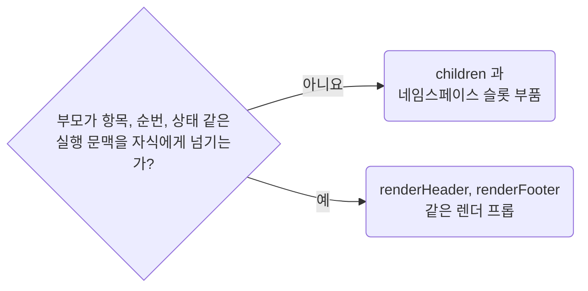

# Prefer Children Over Render Props for Static Composition

**Impact: MEDIUM (실행 문맥이 필요 없는 조립을 JSX 구조로 바로 읽을 수 있습니다)**

상태 없는 합성으로 충분한 공용 컴포넌트는 렌더 프롭보다 `children`을 우선합니다.



같은 슬롯 계약을 둘 이상의 프롭이나 파일이 쓸 때만 타입에 이름을 붙입니다.
`<Owner>`는 그 계약을 소유한 컴포넌트 이름입니다.

| 별도 이름이 필요한 계약 | 이름 |
| --- | --- |
| `ReactNode` 값 | `<Owner>Slot` |
| 실행 문맥을 받아 `ReactNode`를 만드는 함수 | `<Owner>Renderer` |
| 한 번만 쓰는 익명 형태 | 접미사를 붙이려고 새 타입을 만들지 않습니다 |

참고: [React 문서: JSX를 children으로
넘기기](https://react.dev/learn/passing-props-to-a-component#passing-jsx-as-children).

**Incorrect 1 (정적인 구조를 렌더 프롭으로 조립합니다):**

```tsx
// component/ui/panel/panel.tsx
export interface PanelProps {
	renderHeader?: () => ReactNode;
	renderFooter?: () => ReactNode;
}

export const Panel = (props: PanelProps) => {
	return (
		<section className={clsx("panel__root")}>
			{props.renderHeader?.()}
			<ItemList />
			{props.renderFooter?.()}
		</section>
	);
};
```

**Correct 1 (틀 부품이 `children`으로 사용처가 넣을 자리를 엽니다):**

```tsx
// component/ui/panel/panel-root.tsx
import {clsx} from "clsx";

export interface PanelRootProps {
	children: ReactNode;
}

// ----------------------------------------------------------------------------------------
// 패널 틀, 나머지 부품은 이 안에서만 렌더
// ----------------------------------------------------------------------------------------
export const PanelRoot = (props: PanelRootProps) => {
	return <section className={clsx("panel__root")}>{props.children}</section>;
};
```

> 나머지 예시와 예외는 [full rule](../rules/04-04-strategy-prefer-children-over-render-props.md)에 있습니다.
