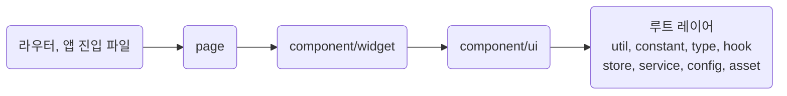

## Keep Component Imports Flowing Downward

**Impact: CRITICAL (공개 범위를 벗어난 가져오기를 막아 컴포넌트의 소유 관계를 유지합니다)**

가져오기는 아래 레이어 방향과 폴더 경계를 **모두** 지킵니다.
모든 경로가 `@/`로 시작하므로 경로 모양이 아니라 가져오는 파일의 위치로 판정합니다.
소유자, 진입 파일, 역할 폴더의 정의는 `ownership-place-owner-files-in-role-folders`를 따릅니다.

### 레이어 방향

가져오기는 화살표 방향으로만 흐릅니다.
중간 레이어는 건너뛸 수 있습니다.

| 가져오는 쪽 | 가져올 수 있는 레이어 |
| --- | --- |
| 루트 레이어 | 루트 레이어 |
| `component/ui` | 루트 레이어, `ui` |
| `component/widget` | 루트 레이어, `ui`, `widget` |
| `page` | 루트 레이어, `ui`, `widget` |
| 라우터와 앱 진입 파일 | 전부 |

같은 레이어의 공개 컴포넌트끼리 조립할 수 있지만 순환 가져오기는 만들지 않습니다.
루트 레이어는 `util`, `constant`, `type`, `hook`, `store`, `service`, `config`, `asset`입니다.

### 폴더 경계

같은 폴더 안의 파일끼리는 자유롭게 가져옵니다.
폴더 밖에서는 그 폴더의 진입 파일과 역할 폴더만 가져옵니다.

| 가져오려는 대상 | 가져올 수 있는 파일 |
| --- | --- |
| `ui`, `widget`의 진입 파일과 역할 폴더 | 레이어 방향을 지키는 파일 |
| 화면과 `Outlet` 프레임의 진입 파일 | 라우터 |
| 다른 화면이나 `Outlet` 프레임 안의 파일 | 없음. 역할 폴더도 같고 같은 그룹 안의 화면끼리도 같습니다 |
| 진입 파일이 아닌 컴포넌트 파일 | 같은 폴더의 파일 |

테스트 파일과 `test/` 아래 gallery story는 마운트할 컴포넌트를 폴더 밖에서도 직접 가져옵니다.
진입 파일이 아닌 컴포넌트의 프롭스 타입도 폴더 밖에서 가져오지 않습니다.
폴더 밖과 함께 쓰는 계약은 `_type`에 둡니다.
`ui`, `widget`의 역할 폴더는 소유자의 공개 영역이므로 외부에서 쓴다는 이유만으로 루트로 옮기지 않습니다.
함수를 루트 `util`로 올릴지는 `typescript/functions-promote-owner-free-functions-to-root-util`이 정합니다.
검사는 `tooling-enable-the-biome-react-domain`의 플러그인과 경로 설정이 맡습니다.

참고: [Feature-Sliced Design: 레이어 가져오기
규칙](https://feature-sliced.design/docs/reference/layers#import-rule-on-layers).

**Incorrect 1 (폴더 밖에서 `widget` 폴더의 진입 파일이 아닌 컴포넌트를 가져옵니다):**

<<< ../examples/ownership-keep-component-imports-flowing-downward/01-incorrect.tsx

**Correct 1 (폴더 밖에서는 진입 파일을 가져옵니다):**

<<< ../examples/ownership-keep-component-imports-flowing-downward/02-correct.tsx

**Incorrect 2 (다른 라우트 안의 컴포넌트를 가져옵니다):**

<<< ../examples/ownership-keep-component-imports-flowing-downward/03-incorrect.tsx

**Correct 2 (두 라우트가 공유하는 화면 독립 컴포넌트는 공용 레이어에 둡니다):**

<<< ../examples/ownership-keep-component-imports-flowing-downward/04-correct-1.tsx
<<< ../examples/ownership-keep-component-imports-flowing-downward/04-correct-2.tsx

**Incorrect 3 (`ui`가 `widget`을 가져옵니다):**

<<< ../examples/ownership-keep-component-imports-flowing-downward/05-incorrect.tsx

**Correct 3 (방향을 뒤집어 `widget`이 `ui`를 가져옵니다):**

<<< ../examples/ownership-keep-component-imports-flowing-downward/06-correct.tsx

**Incorrect 4 (외부에서 사용한다는 이유만으로 역할 폴더의 파일을 루트로 옮깁니다):**

<<< ../examples/ownership-keep-component-imports-flowing-downward/07-incorrect.ts

**Correct 4 (역할 폴더의 파일은 레이어 방향만 지키면 밖에서도 가져옵니다):**

<<< ../examples/ownership-keep-component-imports-flowing-downward/08-correct.ts
