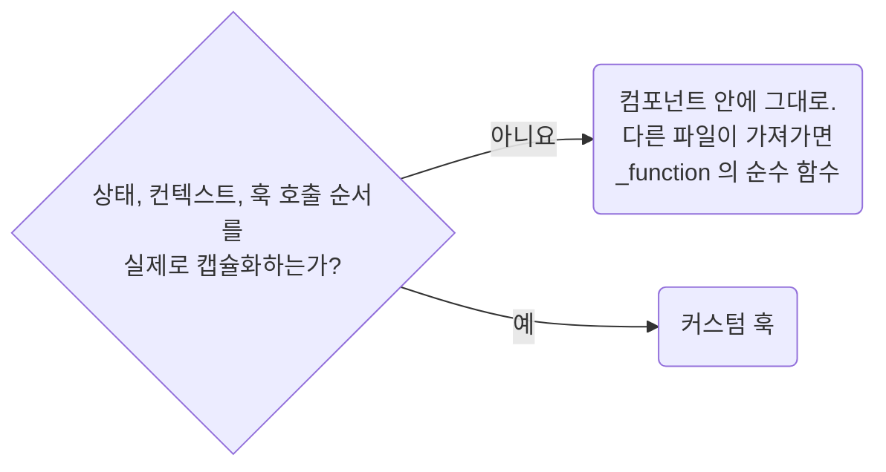

## Do Not Create Screen-local Custom Hooks for Pure Logic

**Impact: HIGH (실제 상태, 생명주기, 컨텍스트가 필요한 경우에만 React 훅을 사용합니다)**

화면 전용 계산, 정규화, 전송 값 조립처럼 순수한 로직은 커스텀 훅으로 감싸지 않습니다.

| 대상 | 처리 |
| --- | --- |
| 순수 계산 | `use` 접두사를 붙이지 않고 쓰는 컴포넌트 안에 둡니다. 테스트를 포함해 다른 파일이 가져갈 때만 `_function`으로 뺍니다 |
| 여러 쿼리를 합친 결과 | 값을 렌더하는 내용물이 `combine`을 소유합니다. 여러 파일이 같은 조합을 호출할 때만 `_hook`으로 옮깁니다 |
| 실제 커스텀 훅 | 기능을 나타내는 `use<Capability>`로 이름 짓습니다. `useData`, `useLogic`처럼 구현 범주만 적지 않습니다 |
| 생명주기가 있는 로직 | 분량을 줄이기 위한 추출은 허용하지 않습니다. `ownership-keep-lifecycle-in-the-owning-component`를 따릅니다 |

함수 추출 여부는 `typescript/functions-extract-helpers-only-when-the-boundary-is-real`을 따릅니다.
배치는 `ownership-place-owner-files-in-role-folders`를 따릅니다.

참고: [React 문서: 커스텀 훅 재사용, 훅을 안 부르면 `use`를 안 붙이고 구체적인 용도로
짓는다](https://react.dev/learn/reusing-logic-with-custom-hooks).

**Incorrect 1 (순수 지역 계산을 커스텀 훅으로 감쌉니다):**

<<< ../examples/ownership-prefer-plain-ts-for-local-react-helpers/01-incorrect-1.tsx

<<< ../examples/ownership-prefer-plain-ts-for-local-react-helpers/01-incorrect-2.ts

**Correct 1 (순수 계산은 훅으로 감싸지 않고 핸들러에서 직접 합니다):**

<<< ../examples/ownership-prefer-plain-ts-for-local-react-helpers/02-correct.tsx
