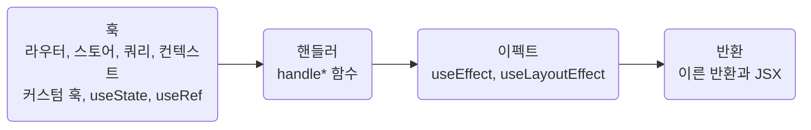

## Order Hooks, Handlers, Effects, Then Return

**Impact: HIGH (컴포넌트마다 훅, 핸들러, 이펙트를 같은 순서로 찾을 수 있습니다)**

컴포넌트 본문은 아래 네 구획 순서로 작성합니다.
렌더 중에 읽는 값은 사용 위치보다 위에서 선언합니다.

이펙트의 인자와 의존성 배열은 해당 줄에서 평가되므로 이펙트를 마지막 훅으로 두어 앞선 선언을 참조합니다.
이른 반환은 모든 훅 뒤에 두어 렌더마다 훅 호출 개수를 유지합니다.
구획 안에서는 선언 뒤에 참조한다는 조건만 지킵니다.
파생값은 `screen-keep-derived-values-close`에 따라 사용처에서 계산합니다.
계산하는 지역 함수와 이름 붙인 판정은 구획을 따로 두지 않고 처음 쓰는 자리 바로 위에 둡니다.
핸들러가 처음 쓰면 그 핸들러 위, 반환만 쓰면 반환 바로 위입니다.

**Incorrect 1 (같은 종류가 흩어지고 이펙트가 아래 선언을 의존성으로 참조합니다):**

<<< ../examples/composition-order-hooks-handlers-effects-then-return/01-incorrect.tsx

**Correct 1 (네 구획이 순서대로 놓입니다):**

<<< ../examples/composition-order-hooks-handlers-effects-then-return/02-correct.tsx

**Incorrect 2 (반환에서만 읽는 판정을 훅 구획에 둡니다):**

<<< ../examples/composition-order-hooks-handlers-effects-then-return/03-incorrect.tsx

**Correct 2 (판정을 처음 쓰는 반환 바로 위에 둡니다):**

<<< ../examples/composition-order-hooks-handlers-effects-then-return/04-correct.tsx
