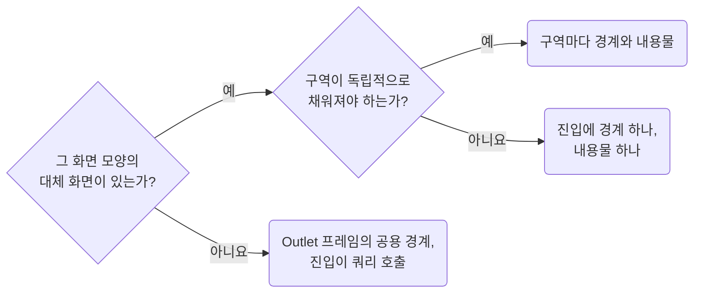

## Place Suspense Boundaries at the Section Owner

**Impact: HIGH (초기 로딩을 쿼리를 부르는 내용물 바로 위의 경계에서 처리합니다)**

`Suspense` 쿼리를 부르는 내용물의 바로 위에 경계와 대체 화면을 둡니다.
쿼리를 호출하는 컴포넌트는 자기 자신을 경계로 감쌀 수 없습니다.

| 상황 | 경계 위치 |
| --- | --- |
| 그 화면 모양의 대체 화면이 있고 구역이 함께 채워져도 됨 | 라우트 진입에 경계 하나. 구역들은 그 아래 내용물 컴포넌트 하나의 JSX입니다 |
| 그 화면 모양의 대체 화면이 없음 | 라우트 진입이 직접 쿼리를 호출하고 경계는 `Outlet` 프레임의 공용 경계가 맡습니다 |
| 구역이 독립적으로 채워져야 함 | 이때만 경계를 나눕니다. 구역마다 경계 하나에 내용물 하나입니다. 한 화면에 불필요하게 여러 겹 쌓지 않습니다 |
| 내용물 안의 구역이 따로 채워져야 함 | 그 내용물이 같은 기준으로 안쪽 경계를 놓습니다 |

대체 화면의 컨테이너, 높이는 `css/layout-keep-layout-intent-explicit`을 따릅니다.
본문에 남은 로딩 분기는 `runtime-avoid-ad-hoc-loading-branches`로 판단합니다.

참고: [React 문서: Suspense, 중첩 경계로 로딩 순서 만들기](https://react.dev/reference/react/Suspense),
[TanStack Query 문서: Suspense](https://tanstack.com/query/latest/docs/framework/react/guides/suspense).

**Incorrect 1 (진입에 경계가 없어 화면 전체가 함께 멈춥니다):**

<<< ../examples/runtime-place-suspense-boundaries-at-the-section-owner/01-incorrect.tsx

**Correct 1 (경계를 놓는 진입이 대체 화면을 가집니다):**

<<< ../examples/runtime-place-suspense-boundaries-at-the-section-owner/02-correct.tsx

**Incorrect 2 (한 화면에 경계를 여러 겹 쌓습니다):**

<<< ../examples/runtime-place-suspense-boundaries-at-the-section-owner/03-incorrect.tsx

**Correct 2 (그 화면 모양의 대체 화면이 없으면 진입이 쿼리를 부르고 `Outlet` 프레임의 경계에 맡깁니다):**

<<< ../examples/runtime-place-suspense-boundaries-at-the-section-owner/04-correct.tsx

**Correct (쿼리를 부르는 내용물은 자기 자신을 감싸지 않습니다):**

<<< ../examples/runtime-place-suspense-boundaries-at-the-section-owner/05-correct.tsx
