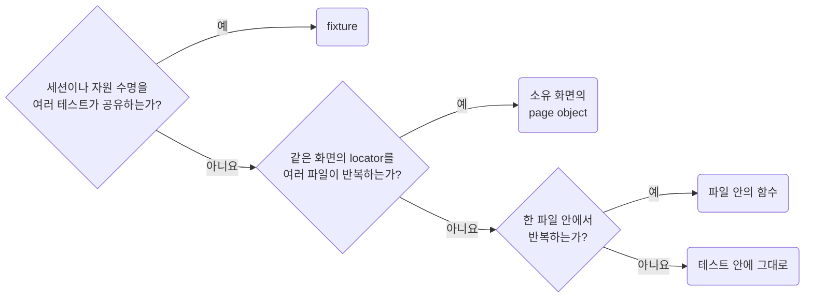

# Share Fixtures and Page Objects at Real Boundaries

**Impact: MEDIUM (테스트의 핵심 시나리오를 숨기지 않고 중복되는 준비와 탐색을 줄입니다)**

공통 세션과 자원 수명은 fixture로 묶고 반복되는 locator와 화면 조작은 먼저 테스트 파일 안의 함수 하나로 묶습니다.
같은 화면의 locator와 조작이 여러 파일에 퍼져 함께 고칠 일이 반복될 때 소유 화면의 page object로 올립니다.
한 번 쓰는 단언이나 작은 동작마다 helper를 만들지 않습니다.



page object는 시나리오의 기대값을 숨기지 않고 테스트가 결과를 단언하게 합니다.
fixture의 의존성 이름과 scope는 실제 사용 범위에 맞추고 테스트별 상태를 worker 전역으로 올리지 않습니다.
fixture 콜백의 매개변수 구조분해는 `typescript/values-read-objects-through-chains`의 예외를 따릅니다.

참고: [Playwright 문서: fixture](https://playwright.dev/docs/test-fixtures),
[Playwright 문서: page object model](https://playwright.dev/docs/pom),
[Software Engineering at Google:
공유 helper와 검증 함수의 위험](https://abseil.io/resources/swe-book/html/ch12.html#shared_helpers_and_validation).

**Incorrect 1 (테스트마다 같은 화면의 locator 체인을 반복합니다):**

```ts
// test/orders/orders.e2e.spec.ts
import { expect, test } from "@playwright/test";

test("목록에 주문이 표시된다", async ({ page }) => {
	// WHEN 주문 목록 진입
	await page.goto("/orders");

	// THEN 목록의 대표 주문
	await expect(page
		.getByRole("table", { name: "주문 목록" })
		.getByRole("row")
		.filter({ hasText: "order-1" })).toBeVisible();
});

test("주문을 누르면 상세로 이동한다", async ({ page }) => {
	// GIVEN 대표 주문이 있는 목록
	await page.goto("/orders");

	// WHEN 대표 주문 링크 클릭
	await page
		.getByRole("table", { name: "주문 목록" })
		.getByRole("row")
		.filter({ hasText: "order-1" }).getByRole("link").click();

	// THEN 선택한 주문의 상세 URL
	await expect(page).toHaveURL(/\/orders\/order-1$/);
});
```

**Correct 1 (반복되는 locator 체인을 테스트 파일 안의 함수로 묶습니다):**

```ts
// test/orders/orders.e2e.spec.ts
import { expect, test } from "@playwright/test";

import type { Page } from "@playwright/test";

// ----------------------------------------------------------------------------------------
// 주문 목록에서 주문 ID가 든 행
// ----------------------------------------------------------------------------------------
const orderRow = (page: Page, orderId: string) => {
	return page
		.getByRole("table", { name: "주문 목록" })
		.getByRole("row")
		.filter({ hasText: orderId });
};

test("목록에 주문이 표시된다", async ({ page }) => {
	// WHEN 주문 목록 진입
	await page.goto("/orders");

	// THEN 목록의 대표 주문
	await expect(orderRow(page, "order-1")).toBeVisible();
});

test("주문을 누르면 상세로 이동한다", async ({ page }) => {
	// GIVEN 대표 주문이 있는 목록
	await page.goto("/orders");

	// WHEN 대표 주문 링크 클릭
	await orderRow(page, "order-1").getByRole("link").click();

	// THEN 선택한 주문의 상세 URL
	await expect(page).toHaveURL(/\/orders\/order-1$/);
});
```

> 나머지 예시와 예외는 [full rule](../rules/05-03-playwright-share-fixtures-and-page-objects-at-real-boundaries.md)에 있습니다.
