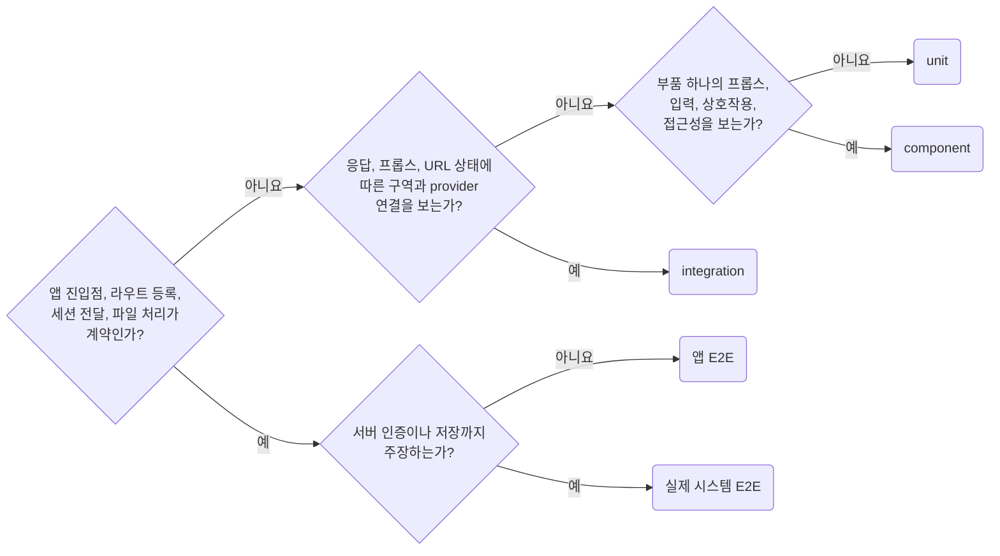

## Choose the Smallest Reliable Test Boundary

**Impact: HIGH (검증에 필요한 실제 경계를 유지하면서 실행 비용과 실패 원인을 줄입니다)**

검증할 계약을 먼저 적고 그 계약이 실제로 실행되는 가장 작은 범위를 선택합니다.
러너 이름이나 화면 수로 테스트 층을 정하지 않습니다.

| 실행 경계 | 작성 기준 |
| --- | --- |
| unit | 계산, 변환, 정렬, 입력 판정을 실제 함수에 인자로 전달합니다 |
| component | 부품 하나를 story로 렌더해 프롭스에 따른 모양, 입력, 상호작용, 접근성을 봅니다. Storybook Vitest addon이 실행합니다 |
| integration | 응답, 프롭스, URL 상태에 따른 구역과 실제 provider의 연결을 봅니다 |
| 앱 E2E | 앱 진입, 라우팅, 세션 전달, 파일 처리의 실제 여정을 통과합니다 |
| 실제 시스템 E2E | 서버 인증, 저장까지 주장할 때 해당 서버와 저장 경계를 포함합니다 |

레이아웃, 측정, 스크롤, canvas처럼 브라우저 동작이 계약이면 실제 브라우저를 사용합니다.
Playwright gallery에서 story를 `mount`해도 앱 전체는 실행되지 않으므로 integration 경계로 봅니다.
화면 하나의 진입, 세션 연결도 앱 경계를 검증하면 E2E이며 화면 수로 나누지 않습니다.

함수의 입력 조합은 unit에, 부품 하나의 상태와 조작은 component에 둡니다.
구역의 로딩, 빈 값, 실패와 조작은 integration에 둡니다.
앱 E2E에는 대표 여정과 연결이 끊겼을 때 실패할 사례를 남깁니다.
mock 서버를 쓰는 앱 E2E가 증명하는 범위는 `network-state-real-and-mocked-system-boundaries`가 정합니다.
단순 래퍼나 서드파티 자체의 동작을 반복하는 테스트는 추가하지 않습니다.

참고: [Ham Vocke: 실용적인 테스트 피라미드](https://martinfowler.com/articles/practical-test-pyramid.html),
[Kent C. Dodds: 테스트 층별 비용과 신뢰](https://kentcdodds.com/blog/write-tests),
[Vitest 문서: 브라우저 모드를 쓰는 이유](https://vitest.dev/guide/browser/why).

**Incorrect 1 (브라우저 전체에서 숫자 포맷만 확인합니다):**

<<< ../examples/scope-choose-the-smallest-reliable-boundary/01-incorrect.test.ts

**Correct 1 (실제 포맷 함수만 실행합니다):**

<<< ../examples/scope-choose-the-smallest-reliable-boundary/02-correct.test.ts
