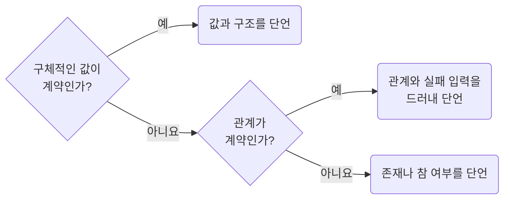

## Derive Expectations from Independent Contracts

**Impact: HIGH (구현과 같은 오류를 기대값에서도 반복해 통과하는 테스트를 막습니다)**

기대값은 요구사항, 직접 확인할 수 있는 작은 예제, 명시적인 불변 관계에서 정합니다.
검증 대상 함수를 다시 호출하거나 제품의 계산식과 상수를 가져와 기대값을 만들지 않습니다.
계약이 정한 값은 리터럴로 직접 적습니다.

구체적인 값이 계약이면 그 값과 구조를 확인합니다.
존재나 참 여부가 계약일 때만 존재 단언을 사용합니다.
관계가 계약이면 정렬 순서, 합계 보존처럼 그 관계와 실패 입력을 분명히 드러냅니다.
기준값 갱신은 `baseline-keep-snapshots-stable-small-and-reviewed`를 따릅니다.

참고: [Google Testing Blog:
테스트에 로직을 넣지 않기](https://testing.googleblog.com/2014/07/testing-on-toilet-dont-put-logic-in.html),
[Vitest 문서: 계약 기준으로 테스트 정하기](https://vitest.dev/guide/learn/testing-in-practice#what-to-test).

**Incorrect 1 (검증 대상 함수를 기대값에서도 호출합니다):**

<<< ../examples/case-derive-expectations-from-independent-contracts/01-incorrect.test.ts

**Correct 1 (직접 확인한 출력값과 비교합니다):**

<<< ../examples/case-derive-expectations-from-independent-contracts/02-correct.test.ts
