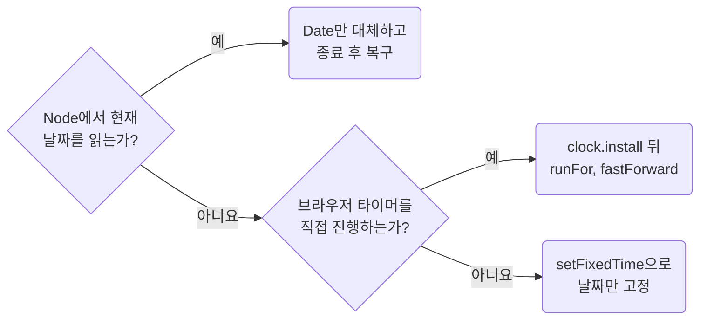

## Control Time Randomness and Environment

**Impact: HIGH (실행 날짜와 실행 위치가 바뀌어도 같은 입력이 같은 결과를 냅니다)**

결과에 영향을 주는 시각과 환경을 테스트 입력으로 고정합니다.
날짜 경계는 오프셋이 있는 기준 시각과 표시 타임존을 함께 정하고 모듈이 처음 값을 읽기 전에 적용합니다.
모듈 최상위가 시각을 읽으면 `vi.hoisted`나 setup 파일에서 그 모듈을 가져오기 전에 적용합니다.

| 실행 위치 | 처리 |
| --- | --- |
| Vitest의 현재 날짜 | `Date`만 필요하면 `Date`를 대체하고 종료 후 복구합니다 |
| Vitest의 타이머 | `vi.useFakeTimers()`로 진행하고 종료 후 `vi.useRealTimers()`로 복구합니다 |
| 난수, 생성 ID | 결과에 드러나는 값만 `vi.spyOn`으로 고정하고 종료 후 복구합니다. 드러나지 않으면 그대로 둡니다 |
| 브라우저 날짜 | `page.clock.setFixedTime`으로 고정합니다. 타이머는 그대로 흐릅니다 |
| 브라우저 타이머 | `page.clock.install` 뒤 `runFor`, `fastForward`로 진행합니다 |
| Node에서 만드는 브라우저 테스트 응답 | 같은 기준 시각을 생성기에 전달합니다. 브라우저 clock이 Node의 `Date`를 바꾸지는 않습니다 |
| 로케일, 타임존, 뷰포트 | 계약에 영향을 줄 때 러너 설정으로 명시합니다 |

타이머 동작 자체를 검증할 때만 시간을 수동으로 진행합니다.
공유 프로세스의 타임존이나 전역 난수 상태를 병렬 테스트가 서로 바꾸지 않게 합니다.

참고: [공식 문서](https://playwright.dev/docs/clock).

**Incorrect 1 (실행하는 날의 날짜를 입력과 기대값에서 함께 읽습니다):**

<<< ../examples/data-control-time-randomness-and-environment/01-incorrect.test.ts

**Correct 1 (Date만 고정하고 종료 시 원래 시간으로 복구합니다):**

<<< ../examples/data-control-time-randomness-and-environment/02-correct.test.ts

**Correct (브라우저 날짜와 `page.route` 응답에 같은 시나리오 기준 날짜를 전달합니다):**

<<< ../examples/data-control-time-randomness-and-environment/03-correct.test.ts
