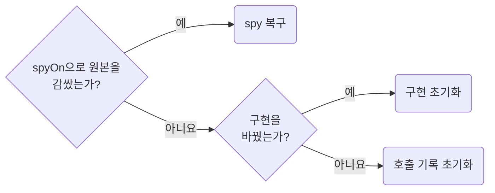

## Isolate and Restore Test State

**Impact: HIGH (단독 실행과 전체 실행에서 같은 결과를 얻고 상태 누수를 막습니다)**

각 테스트는 앞 테스트의 상태 없이 필요한 사전조건을 만들고 자신이 만든 자원을 종료합니다.

### mock 복구

mock의 호출 기록 초기화, 구현 초기화, spy 복구는 서로 다른 동작이므로 바꾼 상태에 맞게 복구합니다.

Vitest 설정의 `restoreMocks`가 이미 spy를 복구하면 `afterEach`를 더하지 않습니다.

### 브라우저 자원과 저장소

브라우저 context, 쿠키와 저장소, 요청 handler, provider의 캐시와 store가 각각 어디서 정리되는지 확인합니다.
러너가 제공하는 정리를 먼저 확인하고 필요한 부분만 추가합니다.
Playwright의 `context` fixture는 실패해도 닫히므로 세션이 없는 사례는 `storageState`를 비워 만들고 직접 열지 않습니다.
직접 연 context와 서버는 실패하더라도 `finally`나 fixture 종료 구간에서 닫습니다.

context 재사용은 격리가 확인된 프로젝트의 최적화로 선택합니다.
단독 실행, 순서 변화, 필요한 병렬 실행에서 결과가 같은지 확인합니다.

참고: [공식 문서](https://playwright.dev/docs/browser-contexts).

**Incorrect 1 (복구하지 않은 spy가 다음 테스트로 남습니다):**

<<< ../examples/data-isolate-and-restore-test-state/01-incorrect.test.ts

**Correct 1 (`afterEach`에서 spy를 복구합니다):**

<<< ../examples/data-isolate-and-restore-test-state/02-correct.test.ts

**Incorrect 2 (실패 경로에서 직접 연 context가 닫히지 않습니다):**

<<< ../examples/data-isolate-and-restore-test-state/03-incorrect.test.ts

**Correct 2 (러너가 닫는 context를 쓰고 `storageState`로 세션을 비웁니다):**

<<< ../examples/data-isolate-and-restore-test-state/04-correct.test.ts

**Correct (러너와 다른 설정으로 직접 연 context를 성공과 실패 모두에서 닫습니다):**

<<< ../examples/data-isolate-and-restore-test-state/05-correct.test.ts
