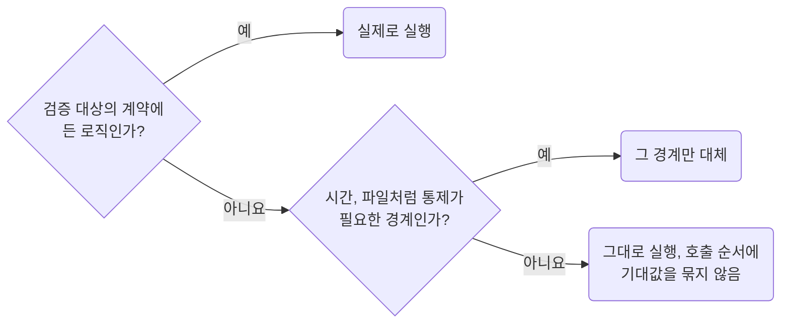

## Mock Dependencies Without Replacing the Subject

**Impact: HIGH (mock 자체의 동작을 검증하며 실제 결함을 놓치는 일을 막습니다)**

검증 대상 함수와 그 계약에 포함된 로직을 실제로 실행합니다.
시간, 파일처럼 통제가 필요한 경계만 대체하고 내부 함수의 호출 순서에 기대값을 묶지 않습니다.
네트워크 응답은 `network-override-transport-and-keep-owned-logic-real`대로 응답 경계에서 바꿉니다.

모듈을 대체할 때는 실제 export 계약에 맞는 mock을 만들고 타입 검사가 되는 import 형태를 사용합니다.
`vi.mock(import(...))`를 경로 별칭과 함께 쓰면 mock 팩터리의 반환 타입이 실제로 검사되는지 확인합니다.
결과로 관찰할 수 없는 외부 부수효과가 계약일 때는 호출 인자와 횟수를 검사할 수 있습니다.
외부 결과가 같은 내부 리팩터링에서는 테스트가 그대로 통과해야 합니다.

참고: [공식 문서](https://vitest.dev/guide/mocking), [vi.mock](https://vitest.dev/api/vi).

**Incorrect 1 (검증할 함수 자체를 대체하고 대체값을 확인합니다):**

<<< ../examples/vitest-mock-dependencies-without-replacing-the-subject/01-incorrect.test.ts

**Correct 1 (검증 대상 모듈의 mock을 지우고 실제 변환을 실행합니다):**

<<< ../examples/vitest-mock-dependencies-without-replacing-the-subject/02-correct.test.ts
