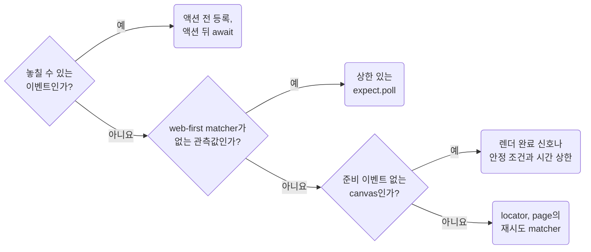

## Wait for State and Register Events Before Actions

**Impact: HIGH (임의의 대기 시간과 이벤트 등록 순서로 생기는 불안정한 실패를 줄입니다)**

화면 상태는 `await expect`와 locator의 재시도 가능한 matcher로 기다립니다.
요청, 다운로드, 팝업처럼 놓칠 수 있는 이벤트는 그 이벤트를 발생시키는 액션 전에 대기를 등록합니다.

### 상태 대기

표시, 문구, 개수, URL은 그 locator나 page의 재시도 matcher로 기다립니다.
web-first matcher가 없는 관측값은 상한이 있는 `expect.poll`로 기다립니다.
준비 이벤트가 없는 canvas는 렌더 완료 신호나 안정된 관측 조건에 시간 상한을 두고 기다립니다.
임의의 sleep, `networkidle`, `force` 옵션으로 준비 상태를 대신하지 않습니다.
`expect.poll`과 `toPass`의 `intervals`는 안정화에 필요한 반복 간격입니다.
제품이 정한 지연 시간(2초 안에 사라져야 한다 등)은 그 값을 `timeout`으로 적은 별도 단언으로 둡니다.
실패하면 마지막 관측값이 남도록 단언 메시지를 씁니다.

### 이벤트 등록

`page.waitForEvent`, `page.waitForResponse`가 돌려준 Promise를 액션 전에 만들고 액션 뒤에 `await`합니다.
액션 뒤에 등록하면 그 사이에 끝난 이벤트를 놓칠 수 있습니다.

참고: [공식 문서](https://playwright.dev/docs/best-practices#use-web-first-assertions).

**Incorrect 1 (고정 시간 뒤에 한 번만 문구를 읽습니다):**

<<< ../examples/playwright-wait-for-state-and-register-events-before-actions/01-incorrect.test.ts

**Correct 1 (문구가 계약을 만족할 때까지 제한 시간 안에서 재시도합니다):**

<<< ../examples/playwright-wait-for-state-and-register-events-before-actions/02-correct.test.ts

**Correct (액션 전에 등록한 대기로 다운로드 이벤트를 놓치지 않습니다):**

<<< ../examples/playwright-wait-for-state-and-register-events-before-actions/03-correct.test.ts
