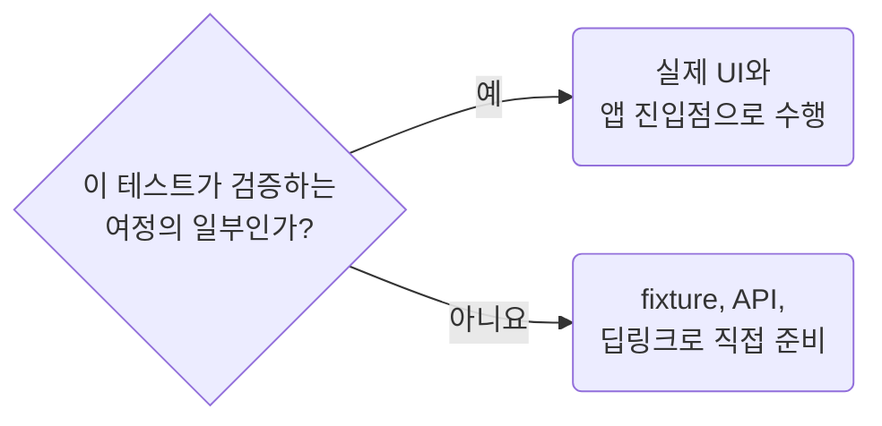

## Prepare State and Exercise the Target Journey

**Impact: HIGH (불필요한 탐색을 줄이면서 라우팅과 상태 전달의 연결을 실제로 검증합니다)**

검증 전 사전조건은 fixture, API, 딥링크로 직접 준비할 수 있습니다.
검증 대상인 클릭, 이동, URL 상태 전달은 실제 UI와 앱 진입점을 통과합니다.

목록에서 상세로 이동하는 계약이면 상세 URL을 바로 열어 대신하지 않습니다.
서버 로그인 자체가 대상이 아니면 매 테스트마다 로그인 UI를 반복하지 않습니다.
뒤로가기, 새로고침, 지속성이 대상이면 그 과정에서 필요한 저장소를 지우거나 라우터를 새로 만들지 않습니다.

참고: [공식 문서](https://playwright.dev/docs/best-practices).

**Incorrect 1 (상세 URL로 바로 열어 목록 링크의 연결을 건너뜁니다):**

<<< ../examples/playwright-prepare-state-and-exercise-the-target-journey/01-incorrect.test.ts

**Correct 1 (사전조건인 목록 URL부터 검증할 링크로 이동합니다):**

<<< ../examples/playwright-prepare-state-and-exercise-the-target-journey/02-correct.test.ts
