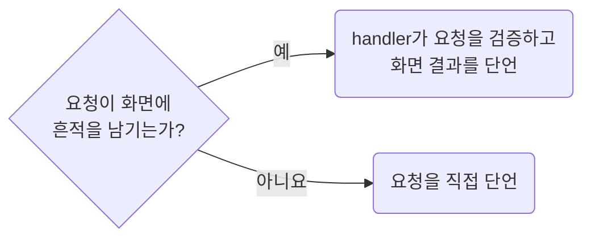

## Override Transport and Keep Owned Logic Real

**Impact: HIGH (요청 조립과 응답 변환, provider, 화면 상태의 실제 연결을 확인합니다)**

화면 상태를 검증할 때는 네트워크 경계에서 필요한 응답만 교체합니다.
화면의 hook, 응답 매퍼, provider를 대체하거나 DOM을 직접 써서 기대 화면을 만들지 않습니다.

공유 handler의 기본 응답과 덮어쓰기 handler를 구분하고 덮어쓰기 handler는 요청이 시작되기 전에 등록합니다.
요청 필드는 handler가 검증해 잘못되면 오류 응답을 돌려주고 화면 결과로 확인합니다.
화면에 흔적이 남지 않는 요청만 직접 단언합니다.
응답 본문을 spec에서 직접 적는 `page.route`는 생성기가 없는 프로젝트에서만 씁니다.
생성기가 있으면 `network-compose-generated-contracts-through-owned-builders`의 handler를 `mockApi.use`로 덮습니다.
worker가 켜진 앱 E2E에서는 `page.route`가 worker가 처리하는 요청을 가로채지 못합니다.
그래서 `page.route`는 `serviceWorkers: "block"`인 project에서만 씁니다.

참고: [MSW 문서: 요청 단언 피하기](https://mswjs.io/guides/best-practices/avoid-request-assertions),
[Playwright 문서: service worker 차단](https://playwright.dev/docs/network#missing-network-events-and-service-workers),
[Kent C. Dodds: fetch를 mock하지 말고 네트워크 경계에서 처리](https://kentcdodds.com/blog/stop-mocking-fetch).

**Incorrect 1 (응답 처리 대신 DOM에 기대 문구를 직접 씁니다):**

<<< ../examples/network-override-transport-and-keep-owned-logic-real/01-incorrect.test.ts

**Correct 1 (API 응답을 바꾸고 실제 화면의 표시를 확인합니다):**

<<< ../examples/network-override-transport-and-keep-owned-logic-real/02-correct.test.ts

**Correct (생성기가 없는 프로젝트는 worker를 차단하고 응답 본문을 직접 덮습니다):**

<<< ../examples/network-override-transport-and-keep-owned-logic-real/03-correct.test.ts
