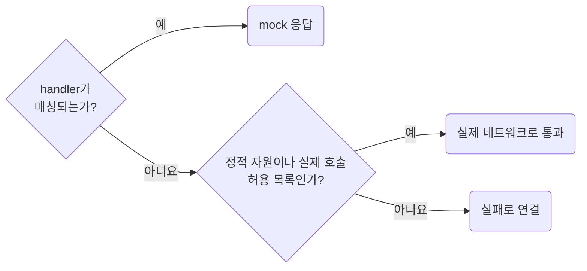

## Detect Unhandled API Requests

**Impact: HIGH (누락된 mock이 외부 네트워크나 무관한 기본 응답으로 숨지 않습니다)**

mock으로 검증하는 API 요청은 처리 누락이 드러나게 설정합니다.
정적 자원이나 명시적으로 실제 호출할 경로는 허용 목록으로 구분하고 전체 우회를 기본값으로 숨기지 않습니다.

handler의 매칭 조건과 우선순위, 덮어쓰기 handler의 초기화를 확인합니다.
`page.route`의 `fallback`은 앞서 등록된 handler로 넘기는 용도와 실제 네트워크로 빠지는 경우를 구분합니다.
MSW 2.x 기준입니다.
3.x는 `onUnhandledFrame`과 `{ frame, defaults }` 콜백을 씁니다.

오류 로그만으로 테스트 실패가 보장된다고 가정하지 않고 실행 결과에 연결되는지 확인합니다.
MSW worker는 미처리 API를 구별할 표식을 기록합니다.
mock 앱 E2E의 실행 fixture가 종료 때 그 기록으로 누락을 단언합니다.
화면이 fetch 실패를 처리하거나 다른 화면으로 이동해도 기록이 사라지지 않게 Node 쪽에 보관합니다.

참고: [MSW의 미처리 요청 옵션](https://mswjs.io/docs/api/setup-server/listen).

**Incorrect 1 (처리되지 않은 API 요청을 모두 우회합니다):**

<<< ../examples/network-detect-unhandled-api-requests/01-incorrect.test.ts

**Correct 1 (미처리 요청을 오류로 드러냅니다):**

<<< ../examples/network-detect-unhandled-api-requests/02-correct.test.ts

**Correct (MSW worker가 남긴 미처리 API 표식을 mock 앱 E2E fixture가 종료 때 단언합니다):**

<<< ../examples/network-detect-unhandled-api-requests/03-correct.ts
<<< ../examples/network-detect-unhandled-api-requests/04-correct.ts
