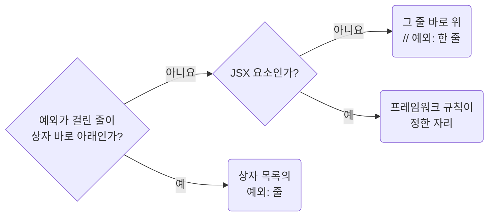

# Justify Convention Exceptions With a Checkable Reason Comment

**Impact: MEDIUM (예외가 취향인지 근거가 있는지 코드에서 바로 드러납니다)**

### 확인할 수 있는 근거

규칙이 허용한 예외에는 다른 사람이 확인할 수 있는 근거를 주석으로 남깁니다.
“성능을 위해”, “안전하게”, “필요해서”처럼 확인할 수 없는 말은 예외의 근거가 되지 않습니다.

| 근거 | 적을 내용 |
| --- | --- |
| 외부 패키지, API 제약 | 어떤 API가 무엇을 요구하는지 |
| 측정 결과 | 측정 대상과 수치 |
| 제품 명세, 티켓 | 결정이 기록된 위치 |
| 상수 | 파일 위쪽이나 `constant`, `_constant` 폴더에 선언된 이름 |

### 주석 자리

예외 이유는 `예외:`로 시작합니다.



예외가 걸린 줄 바로 위에 `// 예외: …` 한 줄로 적습니다.
예외가 걸린 줄이 상자 바로 아래면 상자와 코드 사이에 끼우지 않고 상자 목록에 `예외: …` 한 줄로 적습니다.
어투와 상자 모양은 `docs-write-korean-comments-about-purpose-and-constraints`를 따릅니다.

참고: [Biome 문서: 억제 주석 형식 `biome-ignore 규칙: 설명`](https://biomejs.dev/analyzer/suppressions/),
[typescript-eslint 문서: ban-ts-comment(지시 주석에 설명 요구)](https://typescript-eslint.io/rules/ban-ts-comment/).

**Incorrect 1 (확인할 수 없는 말로 예외를 정당화합니다):**

```ts
// 예외: 성능을 위해 메모이제이션
const columns = useMemo(() => {
	return buildTableColumns(responseTableColumnsSuspense.data.columns);
}, [responseTableColumnsSuspense.data.columns]);
```

**Correct 1 (외부 패키지의 제약을 가리킵니다):**

```ts
// 예외: columns 참조 유지, MUI Data Grid는 columns 참조 변경 → 열 너비와 순서 유실 가능
const columns = useMemo(() => buildTableColumns(responseTableColumnsSuspense.data.columns), [responseTableColumnsSuspense.data.columns]);
```

> 나머지 예시와 예외는 [full rule](../rules/06-04-docs-justify-convention-exceptions-with-a-reason-comment.md)에 있습니다.
