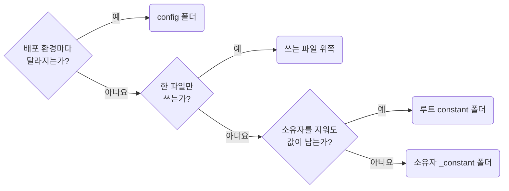

## Place Project-wide Constants in the Root `constant` Folder

**Impact: HIGH (프로젝트 전반의 상수를 주제별로 모아 위치와 이름을 일관되게 유지합니다)**

### 상수 자리 고르기

한 파일만 쓰는 상수는 그 파일 위쪽에 둡니다.
다른 파일도 쓰게 되면 그때 아래 흐름으로 자리를 정해 옮깁니다.
소유자 전용 배치는 `naming-place-owner-constants-in-the-owner-constant-folder`를 따릅니다.

| 쓰는 범위 | 파일 | 이름 |
| --- | --- | --- |
| 한 파일 | 쓰는 파일 위쪽 | `<주제>_<이름>` |
| 한 소유자의 여러 파일 | `<owner>/_constant/<주제>.ts` | `<주제>_<이름>` |
| 프로젝트 전반 | `constant/<주제>.ts` | `<주제>_<이름>` |

### 선언과 내보내기

| 선언 대상 | 규범 |
| --- | --- |
| 파일, 상수 이름 | 파일마다 주제를 하나 정하고 상수에 주제 접두사를 붙입니다. 한 단어 상수는 만들지 않습니다 |
| 내보내기 | `constant`, `_constant` 파일에서는 상수마다 이름 붙여 내보냅니다. `config` 같은 색인 객체로 묶지 않습니다 |
| 파일 위쪽 상수 | 쓰는 파일의 `import` 아래에 선언하고 내보내지 않습니다. 다른 파일이 쓰게 되면 내보내지 말고 옮깁니다 |
| 객체, 배열 값 | 함께 읽히는 값이면 상수 하나로 둡니다. 펼치는 것은 내보낼 이름이지 값의 구조가 아닙니다 |
| 사용자에게 보이는 문장 | 여러 파일이 쓰거나 번역 대상이면 `copy_empty_value_text`처럼 `copy` 주제로 모아 번역 파일로 옮기기 쉽게 둡니다 |
| 한 곳에서만 쓰는 문장 | 쓰는 자리에 그대로 적습니다 |
| 환경마다 달라지는 값, 기능 플래그 | `naming-read-environment-values-through-config-env`에 따라 `config`에 둡니다 |
| 색상, 간격 등 디자인 토큰 | 스타일시트의 CSS 변수를 단일 출처로 둡니다 |

파일, 심볼 표기는 `naming-use-consistent-file-and-symbol-naming`을 따릅니다.
`constant`에는 코드와 함께 바뀌는 값만 둡니다.

**Incorrect 1 (둘 이상의 파일이 같은 값을 각자 선언합니다):**

<<< ../examples/naming-place-project-constants-in-the-root-constant-folder/01-incorrect-1.ts

<<< ../examples/naming-place-project-constants-in-the-root-constant-folder/01-incorrect-2.ts

**Correct 1 (두 번째 파일이 쓰게 된 값은 루트 `constant` 폴더로 옮겨 두 파일이 가져옵니다):**

<<< ../examples/naming-place-project-constants-in-the-root-constant-folder/02-correct-1.ts

<<< ../examples/naming-place-project-constants-in-the-root-constant-folder/02-correct-2.ts

**Incorrect 2 (객체 하나에 모아 색인을 손으로 유지합니다):**

<<< ../examples/naming-place-project-constants-in-the-root-constant-folder/03-incorrect.ts

**Correct 2 (주제 파일에 상수를 하나씩 이름 붙여 내보냅니다):**

<<< ../examples/naming-place-project-constants-in-the-root-constant-folder/04-correct.ts
