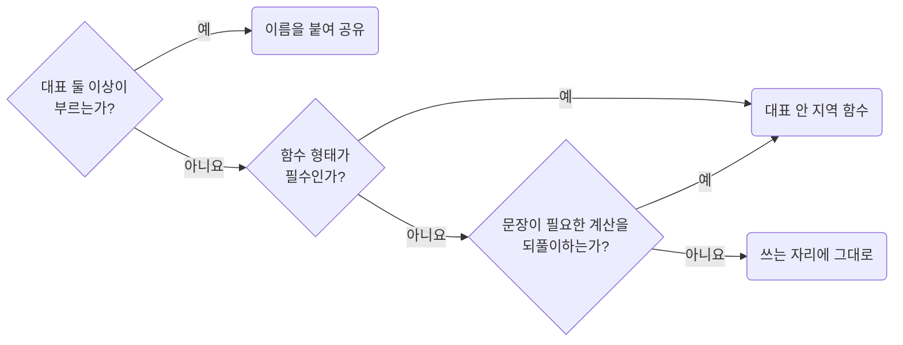

## Extract Support Functions Only When the Boundary Is Real

**Impact: HIGH (불필요한 함수 분리를 줄여 호출부에서 처리 흐름을 읽을 수 있습니다)**

### 이름을 붙이는 사유

한 곳에서만 쓰는 단계는 호출부에 둡니다.
대표 함수는 파일이 내보내는 함수이고 컴포넌트 파일에서는 컴포넌트입니다.

| 사유 | 조건 |
| --- | --- |
| 대표 둘 이상이 부름 | 서로 다른 대표가 같은 계산을 부름. 식 하나여도 해당함 |
| 함수 형태가 필수 | 분기 셋 이상인 판정, `value is T` 타입 가드, 재귀 |
| 문장이 필요한 계산을 되풀이함 | 지역 변수나 `if`가 있어야 적히는 같은 계산을 한 대표 안 두 자리 이상에서 씀 |

식 하나로 적히는 계산은 한 대표 안에서 되풀이해도 이름을 붙이지 않고 쓰는 자리마다 적습니다.
줄 수나 쓰는 횟수가 아니라 식 하나로 적히는지로 가릅니다.
소유자를 지워도 남는 계산은 지역 함수로 두지 않고 `functions-promote-owner-free-functions-to-root-util`을 따릅니다.
파일로 뺀 함수는 바깥 변수, 훅, 컴포넌트 상태 없이도 뜻이 통해야 합니다.

### 추출을 검토할 때

| 추출을 검토하는 이유 | 처리 |
| --- | --- |
| `.map()` 콜백 하나에서만 쓰는 변환 | 그 콜백에 둡니다 |
| 값이 두 분기로 갈림 | 호출부에서 삼항 하나로 씁니다 |
| 값이 세 분기 이상으로 갈림 | 함수로 두고 분기마다 `return`으로 끝냅니다 |
| `.tsx` 파일의 요청 조립을 `.ts` 파일로 옮기고 싶음 | 사유가 아닙니다. 위 사유가 없으면 쓰는 자리에 둡니다 |

분기를 줄이려면 추출 전에 `absence-check-once-at-the-boundary`와
`values-decide-once-and-carry-the-result`를 먼저 봅니다.
함수 배치는 `functions-give-each-function-its-own-file`이 정합니다.
루트 승격은 `functions-promote-owner-free-functions-to-root-util`이 정합니다.

참고: [John Carmack: Inlined Code](https://number-none.com/blow/john_carmack_on_inlined_code),
[Carson Gross: Locality of Behaviour](https://htmx.org/essays/locality-of-behaviour/),
[Sandi Metz: 잘못된 추상화](https://sandimetz.com/blog/2016/1/20/the-wrong-abstraction).

**Incorrect 1 (한 자리에서만 쓰는 단계를 함수로 떼어 내 흐름이 파일 안에서 흩어집니다):**

<<< ../examples/functions-extract-helpers-only-when-the-boundary-is-real/01-incorrect-1.txt

<<< ../examples/functions-extract-helpers-only-when-the-boundary-is-real/01-incorrect-2.ts

**Correct 1 (한 번 쓰는 단계는 대표 본문에 두고 구획 상자로 구간을 나눕니다):**

<<< ../examples/functions-extract-helpers-only-when-the-boundary-is-real/02-correct-1.txt

<<< ../examples/functions-extract-helpers-only-when-the-boundary-is-real/02-correct-2.ts

**Incorrect 2 (한 번만 쓰는 한 줄 계산을 파일로 떼어 내 호출부가 가져옵니다):**

<<< ../examples/functions-extract-helpers-only-when-the-boundary-is-real/03-incorrect.tsx

**Correct 2 (작은 계산은 쓰는 자리에 그대로 둡니다):**

<<< ../examples/functions-extract-helpers-only-when-the-boundary-is-real/04-correct.tsx

**Incorrect 3 (식 하나로 적히는 금액 문자열을 두 번 쓴다고 지역 함수로 묶습니다):**

<<< ../examples/functions-extract-helpers-only-when-the-boundary-is-real/05-incorrect.ts

**Correct 3 (식 하나로 적히는 계산은 쓰는 자리마다 그대로 적습니다):**

<<< ../examples/functions-extract-helpers-only-when-the-boundary-is-real/06-correct.ts

**Incorrect 4 (`filter` 뒤 묶음을 만드는 문장을 상태마다 되풀이해 적습니다):**

<<< ../examples/functions-extract-helpers-only-when-the-boundary-is-real/07-incorrect.ts

**Correct 4 (문장이 필요한 계산은 대표 안 지역 함수로 두고 부르는 줄보다 위에서 정의합니다):**

<<< ../examples/functions-extract-helpers-only-when-the-boundary-is-real/08-correct.ts

**Correct (서로 다른 파일 둘이 이미 부르는 순수 함수를 뺍니다):**

<<< ../examples/functions-extract-helpers-only-when-the-boundary-is-real/09-correct-1.ts

<<< ../examples/functions-extract-helpers-only-when-the-boundary-is-real/09-correct-2.tsx

**Correct (분기 셋인 판정은 한 번만 써도 대표 안 지역 함수로 두고 분기마다 `return`으로 끝냅니다):**

<<< ../examples/functions-extract-helpers-only-when-the-boundary-is-real/10-correct.ts
