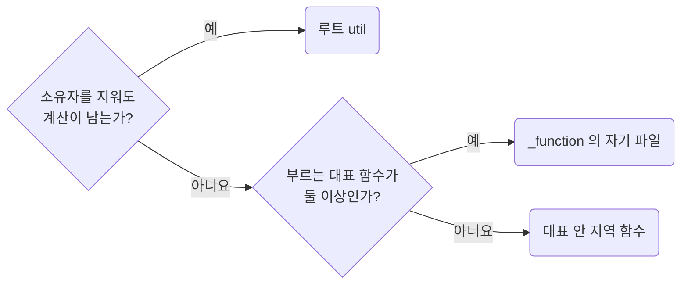

## Give Each Support Function Its Own File

**Impact: HIGH (대표 함수 하나의 흐름을 그 함수 안에서 읽고 여럿이 쓰는 함수는 자기 파일에서 찾습니다)**

### 부르는 대표에 따른 자리

보조 함수에 이름을 붙일지는 `functions-extract-helpers-only-when-the-boundary-is-real`이 정합니다.
이름을 붙였다면 소유자를 지워도 계산이 남는지 먼저 보고 부르는 대표 함수의 수로 자리를 정합니다.

| 보조 함수 | 자리 |
| --- | --- |
| 소유자를 지워도 남는 계산 | `functions-promote-owner-free-functions-to-root-util`을 따릅니다 |
| 대표 하나만 부름 | 대표 안 지역 `const` 함수로 두고 처음 부르는 줄보다 위에서 정의합니다 |
| 같은 소유자의 대표 둘 이상이 부름 | `_function/<보조>.ts`에 내보낸 함수로 둡니다 |

부르는 대표가 둘로 늘면 지역 함수를 `_function/<보조>.ts`로 옮깁니다.
하나로 줄면 남은 대표 안의 지역 함수로 되돌립니다.
다른 소유자가 `_function` 파일을 가져올 수 있는지는 활성화된 프레임워크 규칙이 정합니다.

### 파일 배치 규범

| 배치 대상 | 규범 |
| --- | --- |
| 대표 함수 | 내보낸 함수 하나당 파일 하나이며 파일 이름은 함수 이름입니다 |
| 대표 하나만 쓰는 보조 | 대표 파일 최상위의 비공개 `const`나 다른 파일로 두지 않습니다 |
| `_function` 폴더 | 함수 파일을 하위 폴더 없이 나열합니다 |
| 타입, 상수 | `_function`에 파일로 두지 않습니다. 여러 파일이 쓰면 프레임워크 규칙이 정한 소유자의 역할 폴더에 둡니다 |
| `helper.ts`, `helpers.ts`, `utils.ts` | 여러 보조를 모으는 파일로 만들지 않습니다 |

참고: [Angular 가이드: 파일 하나에 개념 하나](https://angular.dev/style-guide#one-concept-per-file),
[Angular: 막연한 파일 이름 금지](https://angular.dev/style-guide#match-file-names-to-the-typescript-identifier-within),
[John Carmack: Inlined Code](https://number-none.com/blow/john_carmack_on_inlined_code.html).

**Incorrect 1 (여러 보조를 모은 파일에서 내보낸 함수가 세 단계로 이어집니다):**

<<< ../examples/functions-give-each-function-its-own-file/01-incorrect.ts

**Correct 1 (소유자 아래 대표 함수 하나에 파일 하나를 둡니다):**

<<< ../examples/functions-give-each-function-its-own-file/02-correct.ts

**Incorrect 2 (대표 함수 하나만 부르는 보조를 대표 파일 최상위의 비공개 `const`로 둡니다):**

<<< ../examples/functions-give-each-function-its-own-file/03-incorrect.txt

**Correct 2 (대표 함수 하나만 부르는 보조는 대표 안 지역 함수로 둡니다):**

<<< ../examples/functions-give-each-function-its-own-file/04-correct.txt

**Incorrect 3 (대표 함수 하나만 부르는 보조를 `_function`의 자기 파일로 뺍니다):**

<<< ../examples/functions-give-each-function-its-own-file/05-incorrect.txt

**Correct 3 (두 대표가 부르게 된 뒤에 `_function`의 자기 파일로 뺍니다):**

<<< ../examples/functions-give-each-function-its-own-file/06-correct.txt
