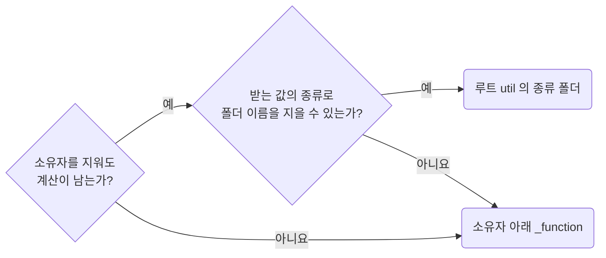

## Promote Owner-Free Functions to the Root util Folder

**Impact: HIGH (소유자 전용 함수를 구분하고 호출부 수가 달라져도 배치 기준을 유지합니다)**

### 승격 판단

루트 `util` 승격은 호출부 수가 아니라 소유자를 지워도 계산이 남는지로 판단합니다.

| 소유자를 지운 결과 | 배치 |
| --- | --- |
| 함수도 사라짐 | 해당 소유자의 `_function`에 둡니다. `toProfileSaveRequest`가 그 예입니다 |
| 함수가 남고 받는 값의 종류로 폴더 이름을 지을 수 있음 | 한 소유자만 써도 `util/<받는 값의 종류>/`에 둡니다. `formatDisplayDate`가 그 예입니다 |
| 함수가 남지만 폴더 이름을 지을 수 없음 | 해당 소유자의 `_function`에 둡니다 |

### 종류 폴더

| 폴더 | 기준 |
| --- | --- |
| `date`, `money`, `string`, `array`, `dom`, `url` | 함수가 받는 값의 타입입니다 |
| `row` 등 도메인 이름 | `Row`처럼 실제 입력 타입이면 허용합니다. 화면, 기능 이름은 쓰지 않습니다 |
| 종류 폴더 안 | 함수마다 파일 하나를 둡니다. 그 함수만 쓰는 보조는 함수 안 지역 함수로 둡니다 |
| 소유자 아래 `_function` | 종류 폴더 없이 함수 파일을 나열합니다 |

### 두 소유자가 공유할 때

| 두 소유자가 공유하는 것 | 처리 |
| --- | --- |
| 표시까지 같음 | 활성화된 프레임워크 규칙이 소유자를 정합니다 |
| 한 소유자의 주제인 계산 | 그 소유자의 `_function`에 둡니다. 다른 소유자가 가져올 수 있는지는 활성화된 프레임워크 규칙이 정합니다 |
| 코드 모양만 같은 계산 | 각 소유자가 따로 갖습니다 |
| 프로젝트 전반의 계산임 | 루트 `util`로 올립니다 |

**Incorrect 1 (소유자와 함께 사라질 함수를 루트 `util`로 올립니다):**

<<< ../examples/functions-promote-owner-free-functions-to-root-util/01-incorrect.ts

**Correct 1 (소유자와 함께 사라질 함수는 그 소유자의 `_function` 폴더에 둡니다):**

<<< ../examples/functions-promote-owner-free-functions-to-root-util/02-correct.ts

**Incorrect 2 (소유자를 지워도 남을 함수를 한 소유자만 쓴다고 그 아래 둡니다):**

<<< ../examples/functions-promote-owner-free-functions-to-root-util/03-incorrect.ts

**Correct 2 (소유자를 지워도 남는 함수는 받는 값의 종류 폴더로 올립니다):**

<<< ../examples/functions-promote-owner-free-functions-to-root-util/04-correct.ts

**Correct (종류 폴더 아래에도 함수마다 파일 하나를 둡니다):**

<<< ../examples/functions-promote-owner-free-functions-to-root-util/05-correct-1.txt

<<< ../examples/functions-promote-owner-free-functions-to-root-util/05-correct-2.ts
