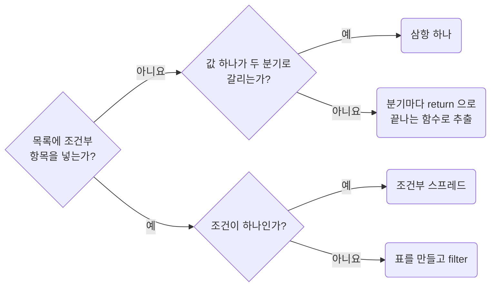

## Avoid Imperative Assembly in Wide Scopes

**Impact: HIGH (분기로 공유 지역 변수를 바꾸지 않아 넓은 스코프의 값 조립이 선언형으로 남습니다)**

모듈 최상위나 함수 본문 최상위에 선언한 변수를 `let` 재할당, `push`, 조건부 누적으로 채워 값을 조립하지 않습니다.
누적 변수를 `if`나 `for` 블록 안에서 선언해 그 안에서만 쓰면 대상이 아닙니다.
삼항 안에 삼항을 넣어 값을 고르지도 않습니다.

추출 여부는 `functions-extract-helpers-only-when-the-boundary-is-real`을 따릅니다.
함수 이름은 `functions-name-functions-by-what-comes-out`을 따릅니다.

참고: [Airbnb JS 가이드: 참조는 const로](https://github.com/airbnb/javascript#references--prefer-const),
[Biome 문서: noNestedTernary](https://biomejs.dev/linter/rules/no-nested-ternary/javascript/).

**Incorrect 1 (넓은 스코프에서 명령형으로 조립을 쌓습니다):**

<<< ../examples/functions-avoid-imperative-assembly-in-wide-scopes/01-incorrect.ts

**Correct 1 (조건부 스프레드로 한 번에 계산합니다):**

<<< ../examples/functions-avoid-imperative-assembly-in-wide-scopes/02-correct.ts

**Incorrect 2 (삼항 안에 삼항을 넣어 값 하나를 고릅니다):**

<<< ../examples/functions-avoid-imperative-assembly-in-wide-scopes/03-incorrect.ts

**Correct 2 (분기가 셋이면 `return`으로 끝나는 함수로 뺍니다):**

<<< ../examples/functions-avoid-imperative-assembly-in-wide-scopes/04-correct.ts

**Incorrect 3 (목록 조립에서 조건 둘이 얽히자 삼항을 겹칩니다):**

<<< ../examples/functions-avoid-imperative-assembly-in-wide-scopes/05-incorrect.ts

**Correct 3 (조건이 둘 이상인 목록은 표로 두고 걸러 냅니다):**

<<< ../examples/functions-avoid-imperative-assembly-in-wide-scopes/06-correct.ts
