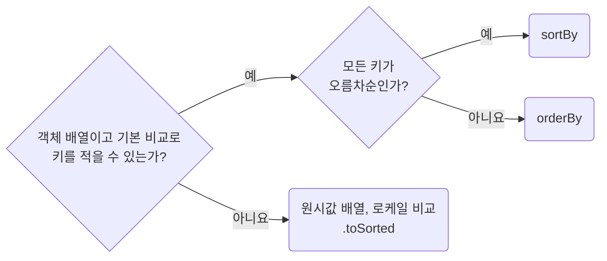

## Prefer Immutable Array Sorting

**Impact: HIGH (프롭스, 상태, 모듈 상수에서 온 배열을 정렬할 때 원본이 바뀌는 버그를 피합니다)**

정렬은 새 배열을 반환하는 `sortBy`, `orderBy`, `.toSorted`로 하고 `.sort()`는 쓰지 않습니다.
프롭스, 상태, 매개변수, 모듈 상수로 받은 배열은 물론 복사본이나 새로 만든 배열에도 같습니다.

`sortBy`와 `orderBy`는 문자열을 `<`로 비교하므로 `localeCompare` 순서와 다릅니다.
로케일 순서가 필요하면 `.toSorted`에 비교 함수를 적습니다.
같은 키의 항목도 입력 순서와 무관하게 정렬해야 하면 고유 ID를 마지막 정렬 키로 더합니다.
입력을 수정하지 않는 정렬 함수는 `readonly` 배열을 매개변수로 받습니다.

참고: [MDN: sort 메서드](https://developer.mozilla.org/en-US/docs/Web/JavaScript/Reference/Global_Objects/Array/sort),
[MDN: toSorted 메서드](https://developer.mozilla.org/en-US/docs/Web/JavaScript/Reference/Global_Objects/Array/toSorted),
[es-toolkit 문서: orderBy](https://es-toolkit.dev/reference/array/orderBy.html).

**Incorrect 1 (매개변수로 받은 배열을 제자리에서 바꿉니다):**

<<< ../examples/values-prefer-immutable-array-sorting/01-incorrect.ts

**Correct 1 (키 기준 정렬은 `sortBy`를 씁니다):**

<<< ../examples/values-prefer-immutable-array-sorting/02-correct.ts

**Correct (방향이 섞이면 `orderBy`를 씁니다):**

<<< ../examples/values-prefer-immutable-array-sorting/03-correct.ts

**Correct (이름을 로케일 순서로 정렬해야 하면 비교 함수를 `.toSorted()`에 적습니다):**

<<< ../examples/values-prefer-immutable-array-sorting/04-correct.ts
