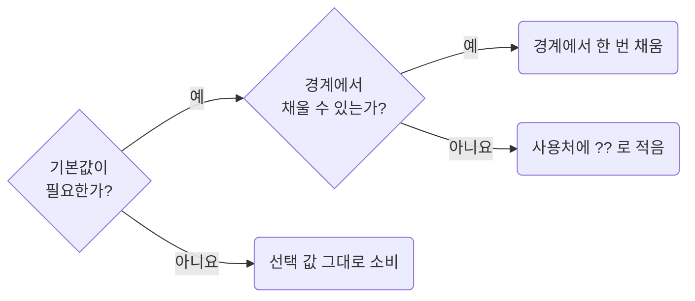

## Resolve Defaults Once at the Boundary

**Impact: HIGH (기본값이 선언 한 곳에 남아 아래쪽 코드에서 `??`가 되풀이되지 않습니다)**

기본값은 필요한지 먼저 확인하고 필요하면 값이 들어오는 경계에서 한 번 채웁니다.
기본값 표현은 `absence-expose-optional-values-instead-of-silent-fallbacks`를 따릅니다.

| 순서 | 판단과 처리 |
| --- | --- |
| 1. 기본값 없이 소비할 수 있는가 | `undefined`를 허용하면 `items?.map(…)`, 선택 값 비교는 `variant === "compact"`로 처리합니다 |
| 2. 경계에서 채울 수 있는가 | search 파라미터 파서의 `.withDefault(선언된 상수)`, 응답 매핑, 쿼리의 `select`에서 한 번 채웁니다. 아래에서는 선택 값과 `??`가 남지 않습니다 |
| 3. 경계에서 처리할 수 없는가 | 사용처에 `fetchProducts({pageSize: query.pageSize ?? pagination_default_page_size})`처럼 적습니다 |
| 4. 같은 기본값을 둘 이상의 사용처가 읽는가 | `pageSize` 대신 `effectivePageSize`처럼 고른 결과임을 드러내는 이름으로 한 번 받습니다. 사용처가 하나면 그대로 적습니다 |

소비처가 배열을 요구하면 경계의 `select`가 선언된 기본값으로 채웁니다.
이름을 붙일지는 `functions-name-a-value-only-for-recompute-or-judgment`가 정합니다.

참고: [nuqs 문서: 기본값(Default values)](https://nuqs.dev/docs/basic-usage#default-values),
[Alexis King: Parse, don't validate](https://lexi-lambda.github.io/blog/2019/11/05/parse-don-t-validate/).

**Incorrect 1 (없어도 되는 값에 기본값을 채웁니다):**

<<< ../examples/absence-resolve-defaults-at-the-boundary/01-incorrect.ts

**Correct 1 (그대로 비교하면 기본값이 필요 없습니다):**

<<< ../examples/absence-resolve-defaults-at-the-boundary/02-correct.ts

**Incorrect 2 (같은 기본값을 사용처마다 다시 채웁니다):**

<<< ../examples/absence-resolve-defaults-at-the-boundary/03-incorrect.ts

**Correct 2 (값이 들어오는 경계에서 한 번 채워 이후 코드에서 기본값을 반복하지 않습니다):**

<<< ../examples/absence-resolve-defaults-at-the-boundary/04-correct.ts

**Correct (경계에서 못 하고 사용처가 하나면 쓰는 자리에 그대로 적습니다):**

<<< ../examples/absence-resolve-defaults-at-the-boundary/05-correct.ts

**Correct (경계에서 못 하고 사용처가 둘 이상이면 고른 결과임이 드러나는 이름으로 한 번 받습니다):**

<<< ../examples/absence-resolve-defaults-at-the-boundary/06-correct.ts
